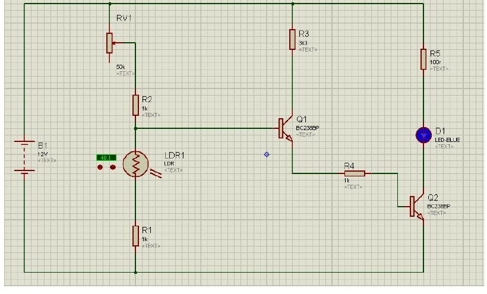
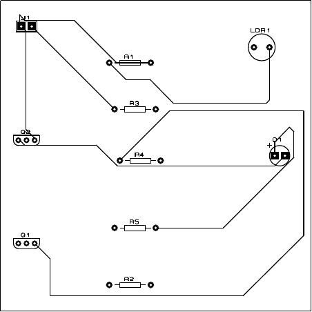

This post describes a small example circuit designed by a friend, based on the **ISIS** (schematic and simulation) and **ARES** (PCB layout) workflow that the supervising engineer explained in Proteus during the summer internship at the TCDD Electronic Maintenance and Repair Center. For the internship report, see the post [TCDD EBOM internship report](/arsiv/staj-eem300-tcdd-ebom-staj-raporu-2013/). The project files (ISIS schematic `.DSN`, ARES layout `.LYT` and PCB output `.PDF`) can be downloaded as a ZIP at the end of the post; they open with Proteus.

## Circuit: LED that lights up in the dark

The circuit turns the LED on by itself when the ambient light decreases. The LDR and R1 form a voltage divider; as the light level drops, the LDR resistance increases and the voltage at the base of transistor Q1 changes, and transistors Q1 and Q2 switch the LED current. The light threshold is adjusted with potentiometer RV1.

| Component | Value |
| --- | --- |
| B1 | 12 V battery |
| RV1 | 50 kΩ potentiometer (threshold adjustment) |
| R1, R2, R4 | 1 kΩ |
| R3 | 3.3 kΩ |
| R5 | 100 Ω (LED series resistor) |
| LDR1 | light-dependent resistor |
| Q1, Q2 | BC238BP (NPN) |
| D1 | blue LED |

## PCB (ARES)

A single-sided board layout and tracks were created in ARES for the same circuit. The output below is the PCB PDF from the project folder.

*Note: The circuit description was derived from the schematic; the source document contains only the schematic, the PCB, and the description "an LDR circuit with a LED that lights up on its own in the dark."*
