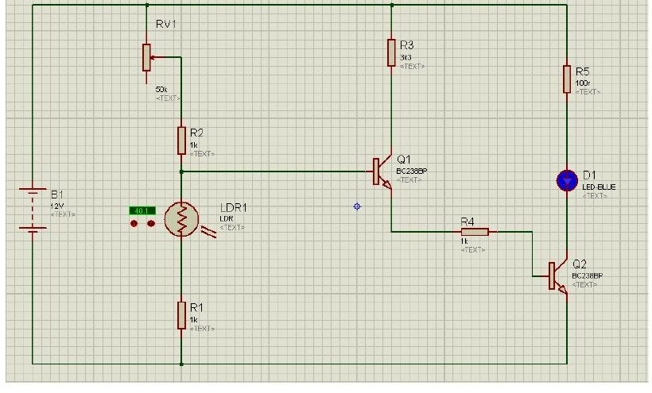
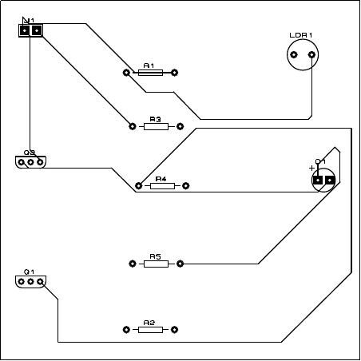

Bu yazı, TCDD Elektronik Bakım Onarım Merkezi'ndeki yaz stajında sorumlu mühendisin Proteus programında anlattığı **ISIS** (şematik ve simülasyon) ve **ARES** (baskı devre) süreci üzerine, bir arkadaşın tasarladığı küçük bir örnek devreyi anlatıyor. Staj raporu için [TCDD EBOM staj raporu](/arsiv/staj-eem300-tcdd-ebom-staj-raporu-2013/) yazısına bakabilirsiniz. Proje dosyaları (ISIS şeması `.DSN`, ARES yerleşimi `.LYT` ve baskı devre çıktısı `.PDF`) yazının sonunda ZIP olarak indirilebilir; Proteus ile açılır.

## Devre: karanlıkta yanan LED

Devre, ortam ışığı azaldığında LED'i kendiliğinden yakar. LDR ve R1 bir gerilim bölücü oluşturur; ışık düştükçe LDR direnci artar ve Q1 transistörünün tabanındaki gerilim değişir, Q1 ve Q2 transistörleri LED akımını anahtarlar. RV1 potansiyometresi ile ışık eşiği ayarlanır.

| Eleman | Değer |
| --- | --- |
| B1 | 12 V pil |
| RV1 | 50 kΩ potansiyometre (eşik ayarı) |
| R1, R2, R4 | 1 kΩ |
| R3 | 3,3 kΩ |
| R5 | 100 Ω (LED seri direnci) |
| LDR1 | ışığa duyarlı direnç |
| Q1, Q2 | BC238BP (NPN) |
| D1 | mavi LED |

## Baskı devre (ARES)

ARES'te aynı devre için tek yüzlü kart yerleşimi ve yollar oluşturuldu. Alttaki çıktı, proje klasöründeki baskı devre PDF'idir.

*Not: Devre açıklaması şemadan çıkarılmıştır; kaynak belgede yalnızca şema, baskı devre ve \"karanlıkta kendi kendine yanan LED içeren bir LDR devresi\" tanımı vardır.*
