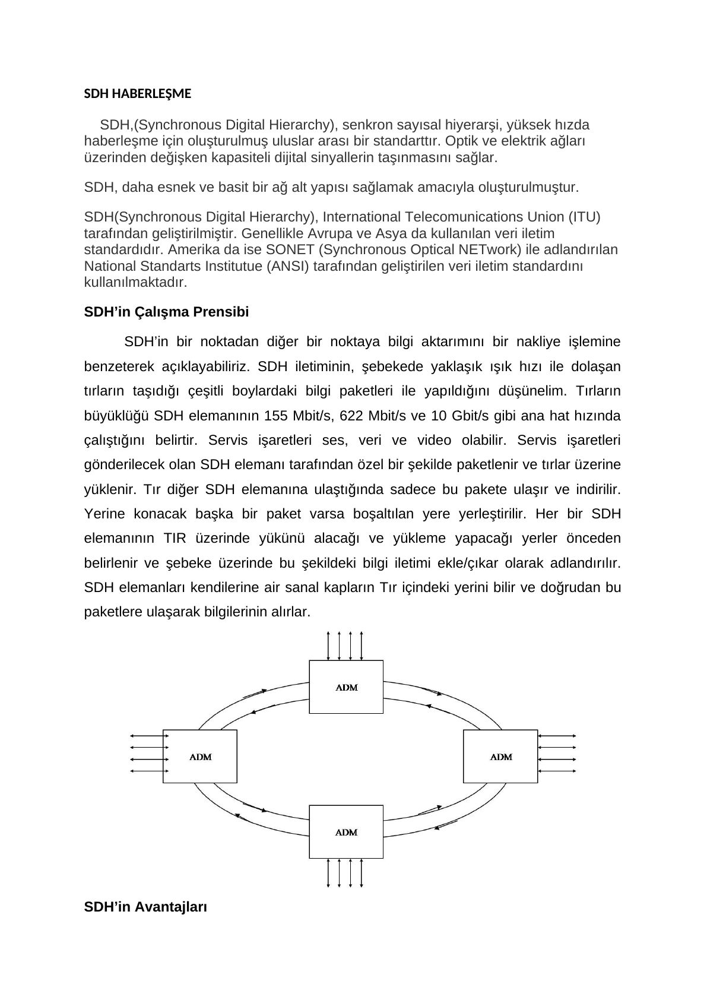

This post is the text of a 12-page **study note** prepared by a friend during the TCDD YHT internship (September 2014): first the SDH (Synchronous Digital Hierarchy) communication system, then physical and logical network topologies (bus, ring, star, extended star, mesh, tree, dual ring, cellular and irregular topologies) are described. The SDH part overlaps with the [telecommunications section](/arsiv/staj-tcdd-yht-telekomunikasyon-gsm-r-sdh-fiber-optik/) of the YHT reports. The note appears to be based on content compiled from the internet (the original figures carry a website watermark, so only one SDH diagram was taken); no sources are cited. The original 12 pages can be downloaded as a PDF at the end of the post. It contains no personal information.

## SDH communications

SDH (Synchronous Digital Hierarchy) is an international standard created for high-speed communications. It enables the transport of digital signals of variable capacity over optical and electrical networks.

SDH was created to provide a more flexible and simpler network infrastructure. SDH (Synchronous Digital Hierarchy) was developed by the International Telecommunications Union (ITU). It is the data transmission standard generally used in Europe and Asia. In America, the data transmission standard called SONET (Synchronous Optical NETwork), developed by the American National Standards Institute (ANSI), is used.

### Operating Principle of SDH

We can explain the transfer of information from one point to another in SDH by likening it to a freight transport operation. Let us imagine that SDH transmission is carried out by information packets of various sizes carried by trucks circulating in the network at approximately the speed of light. The size of the trucks indicates that the SDH element operates at a trunk rate such as 155 Mbit/s, 622 Mbit/s or 10 Gbit/s. The service signals may be voice, data and video. The service signals are packaged in a special way by the sending SDH element and loaded onto the trucks. When a truck reaches another SDH element, that element reaches only its own packet, which is unloaded. If there is another packet to be placed, it is put into the vacated space. The places on the truck where each SDH element will pick up its load and make its loading are determined in advance, and this kind of information transfer over the network is called add/drop. SDH elements know the position within the truck of the virtual containers belonging to them, and they receive their information by reaching these packets directly.

### Advantages of SDH

1. Bit rates above 140 Mbit/s were internationally standardized for the first time.

2. The code for transmission of the optical signal over the line has been standardized. Therefore it is compatible with the line equipment of different manufacturers. Thus manufacturers can produce systems more cheaply for a single world market.

3. Modular structure: the multiplexed bit rates are produced as integer multiples of the basic bit rate. The frame structure of the multiplexed signals is identical to the frame structure of the basic signal. This means that no new frame needs to be defined.

4. Access to a single channel within the multiplexed signal is possible by evaluating the pointer (indicator) data. Since only the desired channels need to be separated out, this method is advantageous for branching with cross-connect systems.

5. Network resources are synchronized to a single master clock.

6. It provides powerful network management capability. This means flexibility and high reliability.

7. Protection and backup against trunk line and network element failures are possible.

8. The transmission of broadband signals envisaged for the future is possible.

9. Conversion of an electrical signal into an optical signal is possible without complex line coding. Error monitoring is carried out through full parity supervision over the various transmission sections.

### Disadvantages of SDH

It is a complex and meticulous technique, since the relationship between the tributary signal and the line in the header has to be recorded.

Because of SDH's American origin, some inadequacies remain in the transmission of CEPT hierarchy signals. For example, although its capacity would allow transmission of a 4x34 Mbit/s signal, only 3x34 Mbit/s of data can be transmitted in STM-1.

*** European countries chose the bit rate of 2048 Kbit/s, while countries such as America, Canada and Japan used the American standard whose basic bit rate is 1544 Kbit/s.

## Network topologies

Topology refers to the physical and logical structure of a network. The ways in which the components forming the network are connected to each other, the devices to be used, cabling standards, the choice of communication protocol and the applicability of these protocols to the structure are also within the scope of topology.

Topology is fundamentally divided into two: physical topology and logical topology.

### Physical topology

It determines the physical connection methods the peripheral units forming the network will use when connecting to each other. The type of cabling to be used in the network structure and the devices to be used are also determined in this topology. The basic network topologies are the star, ring and bus topologies. Examined more broadly, there are 6 types of physical topology. These are the Bus Topology, Ring Topology, Star Topology, Extended Star Topology, Mesh Topology and Tree Topology.

### Bus Topology

A bus topology is formed when all terminals (servers, workstations and other peripheral units) are connected to a linear cable segment along a single cable. This segment is called the trunk. Typically this trunk structure is made of coaxial cable.

In the bus topology, the signal travels past all stations. Each station checks the address of the signal, and all stations the signal passes along the bus either process the signal or passively let it pass, depending on whether this address concerns them. The signal does not travel by being relayed from station to station, but moves along by propagating on its own.

In addition, the bus topology is divided into two kinds: regular and local. The advantages of the bus topology are:

- Computers and other peripheral units can be easily connected to the network
- Less cable is used.
- It is easy to design and expand.
- It is ideal for quickly setting up temporary, non-permanent networks.
- Peripheral connection devices such as switches or hubs are not used, so additional costs are eliminated.
- The failure of one station does not affect the others.
- It is the cheapest topology in terms of scalability.

Its disadvantages are:

- Troubleshooting and management are difficult
- There is a limited number of stations, and the cable length is short.
- A break in the main cable prevents the whole network from operating
- Every additional station added degrades overall network performance
- Terminators are required at both ends of the backbone cable

The most commonly used cabling types known for this topology are coaxial, fiber and twisted pair cable, and the commonly used protocols are the Ethernet and LocalTalk protocols.

### Logical topology

The logical topologies of networks determine how network devices and stations will communicate with each other, and bring them together under a common protocol framework.

### Broadcast Topology

The broadcast topology is based on the rule that each station transmits the signal to all other stations at the same time in the network medium. After broadcasting the signal, the sender searches for the destination by traveling separately across the whole network until it finds the station that matches the address; no relaying is involved.

### Token Passing Topology

This topology is based on an electronic token (signal) visiting each station and circulating around the whole network. The token here acts as a carrier, and at each station it visits, if that station has no data to transmit or distribute at that moment, it passes the token on to the next station, thus acting as a repeater. If there is data to be sent into the network, the station currently holding the token adds the data and puts it into circulation, and the signal is carried in this way.

### Ring Topology

This topology is a circular (or closed-loop) end-to-end connection topology. All units are connected to the ring either directly or via a drop cable and interface. The electrical signal is transmitted from one unit to the next in a single direction. Each unit acts as a receiver on the incoming cable and as a transmitter on the outgoing cable. Since the signal is amplified or regenerated at each unit, attenuation is kept to a minimum. Although this topology is logically a ring, physically it is actually a kind of star topology. The stations are located around a central transceiver called a Multistation Access Unit (MAU).

In a Token Ring structure, a packet reaches the destination address by traveling through all the computers around the ring. The signal delivered to the carrier called the token is received by the stations connected in a ring until it reaches its destination on the network, and each station checks whether the signal is addressed to it; if the address on the signal does not match, it amplifies the signal and passes it again to another station on the ring. When the signal reaches the relevant station, this station returns the token to the original sender, and the medium is prepared again for the next signal transfer on the network. This is why the ring topology is an active topology.

Advantages of the ring topology: Expanding the network has only a very slight positive effect on overall system performance.

All stations have equal access rights.

Its disadvantages are:

- It is the most expensive topology known. It is quite complex. If one station fails, all stations are affected. Twisted pair and fiber optic cabling types are commonly used in this topology. The appropriate protocol is Token Ring.

### Star Topology

A star topology is formed when each terminal (servers, workstations and other peripheral units) is connected directly to central connectors called a switch or hub. Data passes through the switch or hub to reach its destination address. The switch or hub manages and controls all functions of the network. They also work as a repeater/signal amplifier in the network.

Advantages of the star topology:

- Adding new stations is easy. Management and fault detection are simple and can be handled in a short time. It is compatible with different cabling methods. A failure at any station, or the addition of a new unit, does not affect the whole network. Its disadvantages: It requires much more cable compared with other topologies. Problems in the hub or switch devices affect the whole network. As a result of using these devices, its cost is higher than the bus topology. This topology, which is widely used today, uses twisted pair and fiber optic cable types. Ethernet and LocalTalk are likewise the commonly used protocol types of this topology.

### Extended Star Topology

- This topology is defined as a star topology formed around a central node by several interconnected star topologies. The short cabling distance used in this structure is seen as an advantage. Today's telephone network structures can be given as an example of this topology.

### Mesh Topology

The mesh topology is the topology type formed by end-to-end connections among all stations in the network. The cabling used in this structure has very distinct advantages and disadvantages.

The advantages of this structure: Because each station establishes end-to-end connections with the others on its own, multiple connections arise, and thus if any link is broken, the signal can use other links to reach its destination, which is the most important advantage.

When a signal broadcast from one station is directed to different destinations, thanks to the multiple connections it will reach its destinations in the network within a short time, so transfer time is shortened.

Its disadvantages are:

- When there are few nodes in the network and the environment is small, the number of connections that arises appears excessive and the network speed slows down. From a logical perspective, the state and performance of this structure are directly proportional to the number of central distributors and other devices in the network. Also, since each unit in the network requires a connection to every other unit, it generally has a characteristic that is not very practical in application.

### Hierarchical Tree Topology

It is a topology type that fundamentally emerges as a combination of the characteristics of the bus topology and the star topology. The bus model formed by placing star-connected stations on the backbone constitutes the tree topology. From another perspective, the tree topology is logically similar to the extended star topology. The only difference is that the tree topology does not need any central node.

It appears in two forms: backbone tree and binary tree. In the backbone tree model, each node branches into sub-branches in a hierarchical order. In the binary tree structure, each node is divided into only two segments to form the structure. In the tree topology, the signal flow occurs in a hierarchical order. The advantages of this structure:

- A point-to-point cabling structure is used for each segment, so if an interruption occurs in a segment, the others are not affected. Products supplied by different hardware and software manufacturers can work in harmony. Its disadvantages:
- Depending on the type of cabling used, the average length of each segment may not exceed a certain limit. If a break occurs in the main backbone (trunk), the whole network loses its function. In terms of cabling, its configuration is considerably more difficult than all other topologies. One point to consider in this structure is the 5-4-3 Ethernet rule: when a signal is sent, it reaches the other parts of the network within a certain time. Each switch, hub or repeater adds a very small amount of additional time relative to the signal's arrival time. There must be a maximum of 5 segments between two stations in the network, and at the same time there must be physically 4 repeaters, switches or hubs. If coaxial cable is used, there can be only 3 trunks. If the network is installed end-to-end with fiber optic cable, or in a mixed installation with fiber cable and UTP cabling on the backbone, this rule is revised to 7-6-5. The cabling types traditionally used in the tree topology where the Ethernet protocol is used are fiber optic, coaxial and twisted pair cables.

### Dual Ring Topology

The dual ring topology is a structure in which the rings are concentric, and the stations of each ring, connected to each other within the ring, communicate only with the station of the outer ring that is adjacent to them. The rings are not connected to each other and there is no signal exchange between them.

In other words, the dual ring topology is the same as the traditional ring topology, but there is a second ring surrounding the first ring on the outside, and thanks to this outer ring each station exchanges signals with the other stations at the same level as itself. Thus, in order to provide flexibility and reliability in the network, each device becomes the common communication device of two independent rings.

### Cellular Topology

The cellular topology is a topology structure formed by circular or hexagonal areas, each of which has independent nodes around its own center.

This structure, which gains importance with each passing day, uses geographically separated areas through the use of wireless technology. In the connection formed by means of electromagnetic waves, each of the endpoints can be fixed or mobile (e.g., cellular phones in automobiles, satellite links). Its most distinctive advantage is that there is no carrier medium other than the Earth's atmosphere and the vacuum of space. Its disadvantage is that the signal traveling in the medium is open to eavesdropping and monitoring, and the security threats this may bring.

### Irregular Topology

Irregular topology is the name given to the situation in which there is no distinct connection pattern or path among the network components and a distorted model emerges. In this topology the cabling is highly disorganized, and the haphazard connection of a large number of nodes with many cables causes the network to exhibit low performance and to carry out insecure data communication.

*This content may have been compiled from third-party sources; it is shared for archival and nostalgia purposes. It will be removed at the request of the rights holder.*
