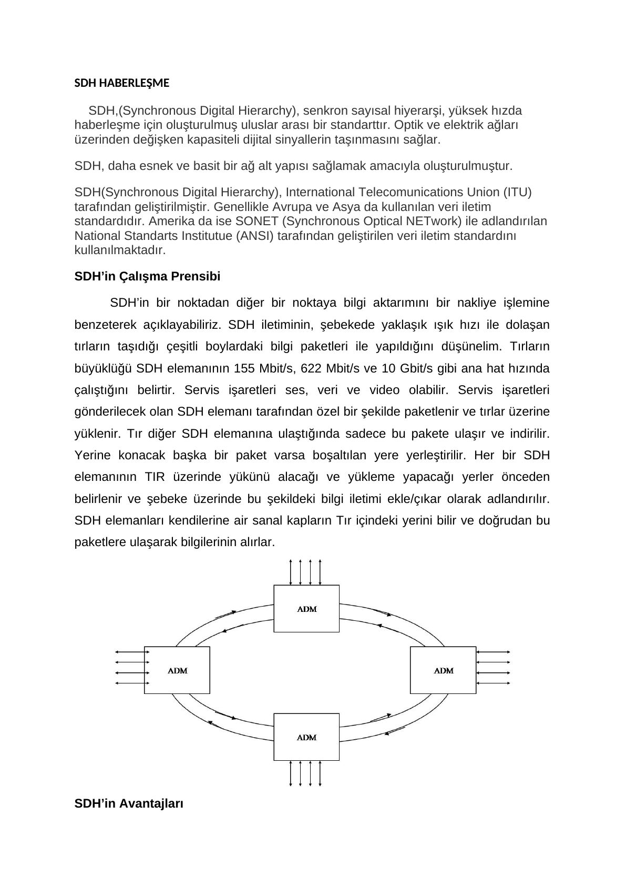

Bu yazı, TCDD YHT stajı sırasında bir arkadaşın hazırladığı 12 sayfalık bir **çalışma notunun** metnidir (Eylül 2014): önce SDH (senkron sayısal hiyerarşi) haberleşme sistemi, sonra fiziksel ve mantıksal ağ topolojileri (bus, halka, yıldız, gelişmiş yıldız, mesh, ağaç, çift halka, hücresel ve eğri topoloji) anlatılır. SDH kısmı, YHT raporlarındaki [telekomünikasyon bölümüyle](/arsiv/staj-tcdd-yht-telekomunikasyon-gsm-r-sdh-fiber-optik/) örtüşür. Not, internetten derlenmiş içeriklere dayanıyor görünür (özgün şekillerinde bir site filigranı var, bu yüzden yalnızca bir SDH şeması alındı); kaynak belirtilmemiştir. Orijinal 12 sayfa yazının sonunda PDF olarak indirilebilir. Kişisel bilgiler yoktur.

## SDH haberleşme

SDH,(Synchronous Digital Hierarchy), senkron sayısal hiyerarşi, yüksek hızda haberleşme için oluşturulmuş uluslar arası bir standarttır. Optik ve elektrik ağları üzerinden değişken kapasiteli dijital sinyallerin taşınmasını sağlar.

SDH, daha esnek ve basit bir ağ alt yapısı sağlamak amacıyla oluşturulmuştur. SDH(Synchronous Digital Hierarchy), International Telecomunications Union (ITU) tarafından geliştirilmiştir. Genellikle Avrupa ve Asya da kullanılan veri iletim standardıdır. Amerika da ise SONET (Synchronous Optical NETwork) ile adlandırılan National Standarts Institutue (ANSI) tarafından geliştirilen veri iletim standardını kullanılmaktadır.

### SDH’in Çalışma Prensibi

SDH’in bir noktadan diğer bir noktaya bilgi aktarımını bir nakliye işlemine benzeterek açıklayabiliriz. SDH iletiminin, şebekede yaklaşık ışık hızı ile dolaşan tırların taşıdığı çeşitli boylardaki bilgi paketleri ile yapıldığını düşünelim. Tırların büyüklüğü SDH elemanının 155 Mbit/s, 622 Mbit/s ve 10 Gbit/s gibi ana hat hızında çalıştığını belirtir. Servis işaretleri ses, veri ve video olabilir. Servis işaretleri gönderilecek olan SDH elemanı tarafından özel bir şekilde paketlenir ve tırlar üzerine yüklenir. Tır diğer SDH elemanına ulaştığında sadece bu pakete ulaşır ve indirilir. Yerine konacak başka bir paket varsa boşaltılan yere yerleştirilir. Her bir SDH elemanının TIR üzerinde yükünü alacağı ve yükleme yapacağı yerler önceden belirlenir ve şebeke üzerinde bu şekildeki bilgi iletimi ekle/çıkar olarak adlandırılır. SDH elemanları kendilerine air sanal kapların Tır içindeki yerini bilir ve doğrudan bu paketlere ulaşarak bilgilerinin alırlar.

### SDH’in Avantajları

1. 140 Mbit/s’nin üzerindeki bit hızları ilk kez uluslararası olarak standartlaştırılmıştır.

2. Optik işaretim hat üzerinden iletimine ait kod standartlaştırılmıştır. Bu nedenle farklı üreticilerin hat donanımları ile uyumludur. Böylece üreticiler tek bir dünya pazrı için daha ucuza sistem üretebilirler.

3. Modüler yapı, çoklama bit hızları temel bit hızın tam katları olarak üretilir. Çoklama işaretlerinin çerçeve yapısı temel işaretin çerçeve yapısı ile özdeştir. Bu da hiçbir yeni çerçevenin tanımlanması gerekmediği anlamına gelir.

4. Çoklama işaretindeki tek bir kanala erişim gösterge verilerinin değerlendirilmesi ile olanaklıdır. Yalnızca istenen kanalların ayrılması gerektiğinden, bu yöntem çapraz bağlama sistemleri ile dallanmada avantajdır. 5. Şebeke kaynakları tek bir master saate senkronizedir.

6. Güçlü ağ yönetimi imkanı sağlar. Bu esneklik ve yüksek güvenirlik demektir. 7. Ana hat ve şebeke elemanı arızalarına karşı koruma ve yedekleme mümkündür.

8. Gelecekte düşünülen geniş bant işaretlerinin iletimi olanaklıdır.

9. Elektrik işaretinin bir optik işarete karmaşık hat kodlaması olmadan dönüşümü olanaklıdır. Bir hata izlemesi, çeşitli iletim bölümlerinde tam eşlik gözetimi yoluyla gerçekleştirilir.

### SDH’in Dezavantajları

Bağımlı işaret ile başlıktaki hat arasındaki ilişkinin kaydedilmesi gerektiğinden dolayı karmaşık ve özenli bir tekniktir.

SDH’in Amerikan kökeninden dolayı CEPT hiyerarşisi işaretlerinin iletimi ile ilgili bazo yetersizlikler devam etmektedir. Örneğin, kapasitesinin 4x34 Mbit/s’lik işaretin iletilmesine olanak vermesine rağmen STM-1’de yalnızca 3x34 Mbit/s’lik bir veri iletilebilmektedir.

*** Avrupa ülkeleri 2048 Kbit/s’lik bit hızını seçerken, Amerika, Kanada ve Japonya gibi ülkeler temel bit hızı 1544 Kbit/s olan Amerikan standardını kullanmışlardır.

## Ağ topolojileri

Topoloji , bir ağın fiziksel ve mantıksal yapısını ifade eder. Ağı oluşturan bileşenlerin birbirlerine bağlanış şekilleri , kullanılacak aygıtlar, kablolama standartları, iletişim protokolünün seçimi ve bu protokollerin yapısına uygulanabilirliği de yine topolojinin kapsamı içerisindedir.

Topoloji mantığı, temel olarak fiziksel topoloji ve mantıksal topoloji olarak ikiye ayrılır.

### Fiziksel topoloji

Ağı oluşturan çevre birimlerinin birbirine bağlanırken kullanacakları fiziksel bağlantı metodlarını belirler. Ağın yapısında kullanılacak kablolama türü ve kullanılacak cihazlar da yine bu topolojide belirlenir. Temel ağ topolojileri Yıldız , halka ve yol topolojileridir. Geniş anlamda incelenecek olursa fiziksel topoloji türleri 6 çeşittir. Bunlar,Yol topolojisi ( Bus Topology ) , Halka Topolojisi ( Ring Topology ) , Yıldız Topolojisi ( Star Topology ),Gelişmiş Yıldız Topolojisi ( Ext Star Topology ) , Ağ topolojisi ( Mesh Topology ), Ağaç Topolojisi ( Tree Topology ) ’ dir.

### Yol topolojisi ( Bus Topology )

Yol topolojisi bir kablo boyunca tüm terminallerin ( Sunucular , iş istasyonları ve diğer çevre birimlerinin ) doğrusal bir kablo segmentine bağlanması sonucu oluşur. Bu segmente Trunk adı verilir. Tipik olarak bu trunk yapısını ise koaksiyel kablo oluşturur.

Yol topolojisinde , sinyal tüm istasyonları dolaşır. Her bir istasyon sinyalin adresini kontrol eder ve bu sinyalin yol üzerinde geçtiği tüm istasyonlar bu adresin kendileri ile ilgili olup olmamaları üzerine sinyali işlerler veya pasif bir şekilde sinyali bırakırlar. Sinyal, istasyonların birbirlerine iletmesi şeklinde değil, kendi başına dolaşarak yol alır.

Ayrıca Yol topolojisi kendi içinde Klasik ( regular ) ve yerel ( Local ) olmak üzere ikiye ayrılır Yol topolojisinin avantajları ;

- Bilgisayarların ve diğer çevre birimlerinin ağa kolayca bağlanabilmesi
- Daha az kablo kullanılması.
- Tasarımı ve genişletilebilirliği kolay olması
- Geçici amaçlı ve kalıcı olmayan ağların hızlı bir şekilde kurulabilmesi için ideal olması.
- Switch veya Hub gibi çevresel bağlantı aygıtlarının kullanılmaması ve böylece ek maliyetlerin ortadan kalkması.
- Bir istasyonun çalışmaması durumunda diğerlerini etkilememesi
- Büyütülebilirlik açısından en ucuz topoloji olması. Dezavantajları ise ;
- Sorun giderilmesi ve yönetimi zor olması
- Kısıtlı sayıda istasyon ve kısa mesafe kablo üzerinde olması.
- Ana kabloda oluşan bir kopmanın tüm ağın çalışmasını engellemesi
- Eklenen her ilave istasyonun toplam ağ performansını kötü anlamda etkilemesi
- Omurga kablonun her iki ucunda sonlandırıcıların bulunma zorunluluğu Bu topolojide bilinen en yaygın kullanılan kablolama tipi Koaksiyel , fiber ve twisted pair kablo , ve yaygın kullanılan protokol ise ethernet ve Localtalk protokolleridir.

### Mantıksal topoloji

Ağların mantıksal topolojileri, ağ aygıtları ve istasyonların birbirleri ile nasıl iletişim kuracaklarını belirleyerek bunları ortak bir protokol çerçevesinde birleştirir .

### Yayın Topolojisi ( Broadcast Topology )

Yayın topolojisi , her istasyonun ağ ortamında sinyali diğer tüm istasyonlara aynı anda iletmesi kuralına dayanır. Yollayıcı , sinyali yayınladıktan sonra adresin eşleştiği istastonu bulduğu ana kadar tüm ağ üzerinden ayrı ayrı dolaşarak hedefi arar, herhangi bir aktarım sözkonusu değildir.

### Token geçiş Topolojisi (Token passing Topology )

Bu topoloji , elektronik bir token’ın ( sinyal ) her bir istasyona uğrayarak tüm ağı dolaşması esasına dayanır. Burada sözü edilen token, bir taşıyıcı görevindedir ve uğradığı her istasyon , o anda iletecek veya dağıtacak herhangi bir dataya sahip değilse token’ı bir sonraki istasyona aktarır ve böylece bir repeater görevi yapmış olur. Şayet ağa sunulacak bir data varsa, token’a o anda sahip olan istasyon datayı ekleyerek dolaşıma sunar ve sinyal bu şekilde taşınmış olur.

### Halka Topolojisi ( Ring Topology )

Bu topoloji , bir dairesel (ya da kapalı döngü) uçtan uca bağlantı topolojisidir. Tüm birimler ya doğrudan ya da bir aktarma kablosu ve arayüz ile halkaya bağlıdır. Elektriksel sinyal bir birimden diğer birime tek bir yönde iletilir. Her birim, gelen kabloda alıcı, giden kabloda gönderici işlevi görür. Sinyal her birimde kuvvetlendirildiği veya yeniden oluşturulduğu için zayıflama en alt düzeydedir. Mantıksal olarak halka şeklinde bir yapıya sahip olan bu topoloji aslında fiziksel olarak bir çeşit yıldız topolojisi şeklindedir. İstasyonlar, Multistation Access Point ( MAU ) adı verilen merkezi bir transreceiver çevresinde bulunurlar.

Token Ring yapıda bir paket, halkanın çevresindeki tüm bilgisayarları dolaşarak hedef adrese ulaşır. Token adı verilen ileticiye teslim edilen sinyal , ağ üzerinde hedefe ulaşana kadar halka şeklinde bağlı bulunan istasyonlarca karşılanır , ve her istasyon sinyalin kendisine gönderildiğini kontrol eder ve şayet sinyalin üzerindeki adres örtüşmüyor ise sinyali güçlendirerek yeniden halka üzerinde diğer bir istasyona iletir. Sinyal, ilgili istasyona ulaştığında, bu istasyon ilk göndericiye Token’ı geri verir ve ağda bir sonraki sinyal taşınımı için yeniden ortam hazırlanır. Bu yüzden halka topolojisi aktif bir topolojidir .

Halka topolojisinin avantajları ; Ağın büyütülmesi, toplam sistem performansına çok az bir oranda olumlu etki yapar.

Tüm istasyonlar eşit erişim hakkına sahiptir.

Dezavantajları ise;

- Bilinen en pahalı topolojidir. Oldukça komplekstir. Bir istasyonun arızası durumunda tüm istasyonlar etkilenir. Bu topolojide yaygın olarak twisted pair ve fiber optik kablolama tipi kullanılır. Uygun protokol ise Token Ring’dir.

### Yıldız Topolojisi ( Star Topology )

Yıldız topolojisi, her bir terminalin (Sunucular, İş istasyonları ve diğer çevre birimlerinin ) switch veya hub adı verilen merkezi konnektörlere direk olarak bağlanması sonucu oluşur. Veri, hedef adresine gitmek için switch veya hub'dan geçer. Switch veya hub ağın tüm fonksiyonlarını yönetir ve kontrol eder. Ayrıca ağda bir tekrarlayıcı/sinyal güçlendirici (repeater) gibi de çalışırlar.

Yıldız topolojisinin avantajları ;

- Yeni istasyonların eklenmesi kolaydır. Yönetimi ve hata tespiti basittir ve kısa zamanda halledilebilir. Birbirinden farklı kablolama metodları ile bağdaşabilir. Herhangi bir istasyondaki arıza veya yeni bir birimin eklenmesi halinde bundan tüm ağ etkilenmez. Dezavantajları ; Diğer topolojilere oranla, çok daha fazla kablo gereksinimi olur. Hub veya Switch cihazlarında ortaya çıkan sorunlarda tüm ağ etkilenir. Bu cihazların kullanılması sonucunda, yol topolojisine göre maliyeti daha yüksektir Günümüzde yaygın bir kullanıma sahip olan bu topolojide twisted pair ve fiber optik kablo türleri kullanılır. Ethernet ve Localtalk ise yine bu topolojinin yaygın olarak kullanılan protokol tipidir.

### Gelişmiş Yıldız Topolojisi ( Extended Star Topology )

- Bu topoloji, birden fazla birbirine bağlı olan yıldız topolojilerinin yine bir merkezi düğüm çevresinde oluşturdukları yıldız topolojisi olarak tanımlanır. Bu yapıda kullanılan kablolama mesafesinin kısa oluşu ise bir avantaj olarak görülür. Günümüzde telefon şebekelerinin yapıları bu topolojiye örnek gösterilebilir.

### Ağ Topolojisi ( Mesh Topology )

Ağ topolojisi, ağdaki tüm istasyonların diğer istasyonlar ile uçtan uca kendi aralarında bağlantıları sonucu oluşan topoloji türüdür. Bu yapıda kullanılan kablolamanın çok belirgin avantaj ve dezavantajları vardır.

Bu yapının avantajları ; Her istasyonun kendi başına diğerleri ile uçtan uca bağlantı kurmasından dolayı, çoklu bağlantı oluşmakta ve böylece herhangi bir bağlantının kopması durumunda, sinyalin hedefine ulaşabilmesi için diğer bağlantıları kullanması en önemli avantajdır.

Bir istasyondan yayınlanan sinyal farklı hedeflere yöneldiğinde çoklu oluşan bağlantı sayesinde kısa süre içerisinde ağdaki hedeflerine varacaktır, böylece taşınım zamanı kısalacaktır.

Dezavantajları ise;

- Ağ üzerinde az sayıda düğümün bulunduğu durumlarda ve ortam boyutunun küçük olması halinde ortaya çıkan bağlantı miktarının çok fazla gözükmesi ve bu durumda ağ hızının yavaşlaması. Mantıksal bir perspektiften bakılacak olunursa, bu yapının durumu, performansı , ağdaki merkezi dağıtıcıların ve diğer cihazların sayısı ile doğru orantılıdır. Ayrıca Ağdaki her birim diğer tüm birimler için birer bağlantı gerektirdiğinden dolayı genellikle uygulamada pek fazla pratik bulunmayan bir özelliğe sahiptir.

### Ağaç Topolojisi ( Hierarchical Tree Topology )

Temel olarak yol topolojisi ile yıldız topolojisinin karakteristik özelliklerinin kombinasyonu şeklinde ortaya çıkan bir topoloji türüdür. Yıldız şeklinde bağlı istasyonların omurga üzerinde konumlanması sonucu oluşan yol modeli ağaç topolojisini oluşturur. Diğer bir yönden , ağaç topolojisi mantıksal açıdan gelişmiş yıldız topolojisine benzer. Tek farkları ise ağaç topolojisinin herhangi bir merkezi düğüme ihtiyaç duymamasıdır.

İki şekilde ortaya çıkar , omurga ağacı ( Backbone tree ) ve ikili ağaç ( binary tree ) . Omurga ağaç modelinde her düğüm hiyerarşik bir düzen içerisinde alt dallara ayrılır. İkili ağaç yapısında ise her düğüm sadece iki segment halinde bölünerek yapıyı oluşturur. Ağaç topolojisi yapısında sinyalin akış şekli hiyerarşik bir düzende oluşur. Bu yapının avantajları ;

- Her bir segment için noktadan noktaya bir kablolama yapısı kullanılır, böylece segmentlerde oluşan bir kesinti halinde diğerleri etkilenmez. Birbirinden farklı donanım ve yazılım üreticilerinin sağladıkları ürünler uyum içerisinde çalışabilir. Dezavantajları ise ;
- kullanılan kablolamanın tipine göre her bir segmentin ortalama uzunluğu belirli bir limiti geçemeyebilir. Eğer ana omurga ( trunk ) yapısında bir kopma olursa tüm ağ işlevini kaybeder. Kablolama açısından konfigürasyonu diğer tüm topolojilerden oldukça daha zordur. Bu yapıda gözönünde bulundurulması gereken bir husus , 5-4-3 ethernet kuralıdır ; Bir sinyalin gönderilmesi anında bu sinyal belli bir süre içinde ağın diğer parçalarına ulaşır. Her bir switch, hub veya repeater sinyalin ulaşma süresine nispeten çok küçük bir zaman dilimi daha ekler. Ağdaki iki istasyon arasında maksimum 5 segment olması gerekir ve aynı zamanda fiziksel olarak 4 repeaters, switches veya hub bulunması gerekir. Şayet koaksiyel kablo kullanılmışsa sadece 3 omurga ( trunk ) olabilir. Eğer ağ uçtan uca fiber optik kablo ile tesis edilmiş ise veya omurgada fiber kablo ve UTP kablolama ile karma tesis edilmiş ise bu kural 7-6-5 olarak revize edilir Ethernet protokolünün kullanıldığı ağaç topolojisinde geleneksel olarak kullanılan kablolama türleri ise fiber optik, koaksiyel, ve twisted pair kablolardır.

### Çift Halka Topolojisi ( Dual Ring Topology )

Çift Halka topolojisi , birbirine eşmerkezli bir yapıda bulunan ve her bir halkanın kendi içinde birbirine bağlı istasyonlarının sadece kendisi ile komşu olan dış halkaya ait istasyon ile iletişim halinde bulunduğu bir yapıdır. Halkalar birbirine bağlı değildir ve aralarında herhangi bir sinyal alışverişi bulunmaz.

Diğer bir deyişle, çift halka topolojisi, geleneksel halka topolojisinin aynısıdır fakat birinci halkayı dıştan kuşatan ikinci bir halka bulunur ve bu dış halka sayesinde her bir istasyon kendilerine eşdüzeyde bulunan diğer istasyonlar ile sinyal alışverişini sağlarlar. Böylece ağdaki esneklik ve güvenilirliği sağlamak üzere her aygıt kendi başlarına bağımsız olan iki halkanın ortak iletişim aygıtı haline gelir. Hücresel Topoloji ( Cellular Topology ) Hücresel topoloji, her birinin kendi merkezi üzerinde birbirinden bağımsız düğümleri bulunan dairesel veya altıgen biçimindeki alanların oluşturduğu topoloji yapısıdır.

Her geçen gün önem kazanan bir özelliğe sahip olan bu yapı, kablosuz teknolojinin kullanımı ile birbirinden farklı bölünmüş coğrafi alanları kullanır. Elektromanyetik dalgalar sayesinde oluşan bağlantıda, uçların her biri sabit veya taşınabilir bir durumda olabilir. ( ör: otomobillerdeki hücresel telefonlar, uydu bağlantı linkleri ) En belirgin avantajı ise dünya atmosferi ve uzay boşluğu haricinde herhangi bir taşıyıcı medyanın bulunmamasıdır. Dezavantajı ise ortamda dolaşan sinyalin dinleme ve izlenmeye açık bir durumda bulunması ve bunun getirebileceği güvenlik tehditleridir.

### Eğri Topoloji ( Irregular Topology )

Eğri Topoloji , ağ bileşenleri arasında belirgin bir bağlantı şekli ve yolunun bulunmadığı, çarpık bir modelin ortaya çıktığı duruma denir. Bu topolojide kablolama oldukça düzensizdir ve çok sayıdaki düğümün birçok kablo ile gelişigüzel bağlantısı ağın düşük performans sergilemesine ve güvensiz veri iletişimi yapmasına neden olur.

*Bu içerik üçüncü taraf kaynaklardan derlenmiş olabilir; arşiv ve nostalji amacıyla paylaşılmıştır. Hak sahibinin talebi hâlinde kaldırılır.*
