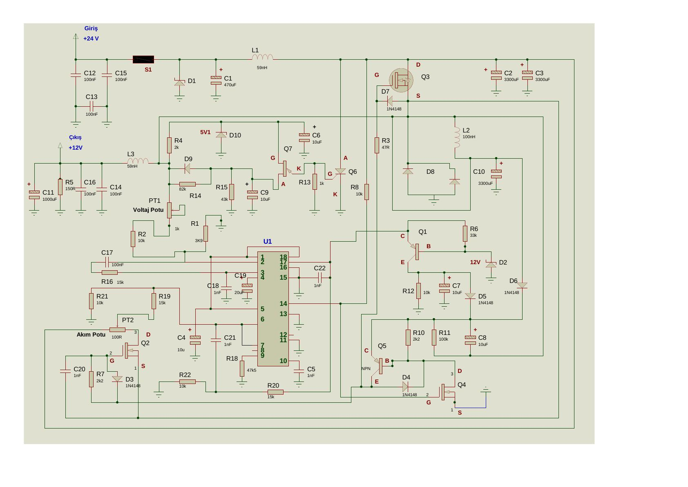
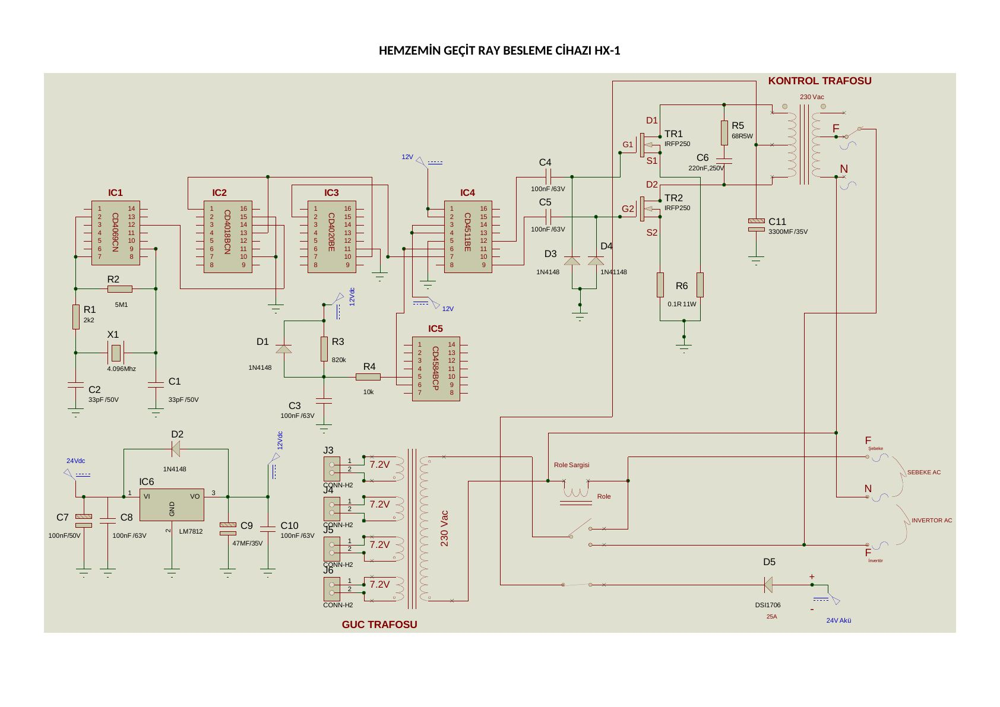

This post brings together three technical documents obtained during an internship at the TCDD Electronics Maintenance and Repair Center (EAM/EBOM, Ankara): the **test procedure for the 24 V DC / 12 V DC 15 A converter**, together with the circuit schematics of the same converter and of the **level crossing rail supply unit HX-1**. The documents are the unit's own work; the source is TCDD EAM. The photographs in the test procedure (the workbench and the measurement setup) have not been published; only the text has been included. The schematics can be downloaded as PDFs at the end of the post.

## 24 V DC / 12 V DC 15 A converter test

The converter's front panel has the input terminals (numbers 1 and 2, 20–30 VDC range), the output terminals (numbers 3 and 4, 12 VDC, 15 A) and a 15 A fuse.

**No-load test**

1. A 24 V supply is applied from a DC power source to inputs 1 and 2.
1. A multimeter (on the DC voltage range) is connected to outputs 3 and 4, and the no-load output voltage is measured.
1. The multimeter should read an output voltage of **13.85 V**. If it does not, the output voltage is fixed at 13.85 V by adjusting potentiometer **PT1**.

**Load test**

1. A load and an ammeter connected in series with it are connected to outputs 3 and 4 together with the multimeter.
1. One end of the load is connected and fixed to output 4; the other end is touched by hand to different lengths of the load (resistance wire), and the output voltage is observed while the load is connected.
1. The multimeter should read an output voltage of **13.72 V**. If it does not, the voltage is fixed at 13.72 V by adjusting potentiometer **PT2**.

When different points along the load wire are touched, according to the formula R = ρ·l/S, with the wire material and cross-sectional area constant, the resistance decreases because the length of wire in use becomes shorter; in the relation V = I·R, with the voltage remaining constant and the resistance decreasing, the current increases in inverse proportion.

The converter has current limiting: when the current exceeds **15 A**, the limiting circuit engages and the output voltage collapses. If the output voltage collapses earlier or later than the 15 A current limit, it is corrected with PT2.

## Converter circuit schematic and level crossing rail supply unit HX-1

Converter schematic: it has a +24 V input and a +12 V output, and includes an input filter (C12, C13, C15, L1), a switching stage with a MOSFET (Q3), the U1 control IC, the voltage potentiometer PT1, the current potentiometer PT2, output filters (L2, L3, C2, C3, C10, C11) and protection components (schematic below).

Level crossing rail supply unit HX-1: a CD4069 oscillator (4.096 MHz crystal), CD4018 and CD4020 counters, and the CD4511 and CD4584 ICs control two IRFP250 MOSFETs (TR1, TR2), which drive the control transformer; a relay switches between the 230 V mains and the 24 V battery/inverter, and the supply is stepped down to 12 V with an LM7812 (schematic below).

