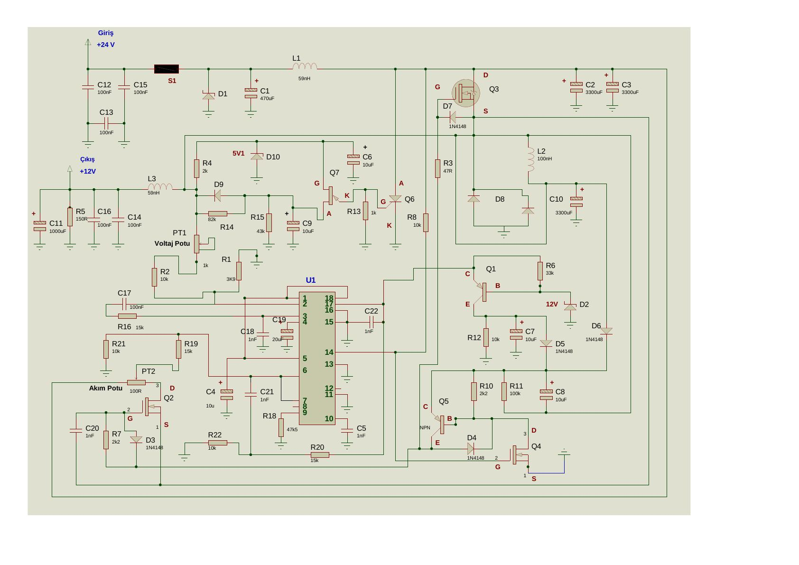
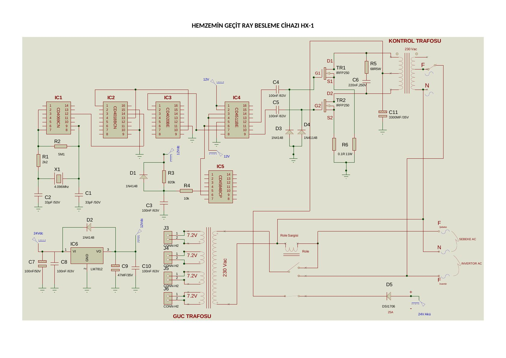

Bu yazı, TCDD Elektronik Bakım Onarım Merkezi'nde (EAM/EBOM, Ankara) staj sırasında elde edilen üç teknik belgeyi bir araya getiriyor: **24 V DC / 12 V DC 15 A konvertörün test talimatı** ile aynı konvertörün ve **hemzemin geçit ray besleme cihazı HX-1**'in devre şemaları. Belgeler birimin kendi çalışmasıdır; kaynak TCDD EAM'dir. Test talimatındaki fotoğraflar (masa üstü ve ölçüm düzeneği) yayınlanmadı, yalnız metni aktarıldı. Şemalar yazının sonunda PDF olarak indirilebilir.

## 24 V DC / 12 V DC 15 A konvertör testi

Konvertörün ön panelinde giriş (1 ve 2 numaralı, 20–30 VDC aralığı), çıkış (3 ve 4 numaralı, 12 VDC, 15 A) klemensleri ve 15 A sigorta bulunur.

**Boşta test**

1. 1 ve 2 numaralı girişlerden DC güç kaynağı ile 24 V gerilim uygulanır.
1. 3 ve 4 numaralı çıkışlardan avometreye (DC gerilim kademesinde) çıkış verilerek boşta çıkış gerilimi ölçülür.
1. Avometrede çıkış gerilimi **13,85 V** görülmelidir. Görülmezse potansiyometre **PT1** ile ayar yapılarak çıkış gerilimi 13,85 V'a sabitlenir.

**Yükte test**

1. 3 ve 4 numaralı çıkışa avometre ile birlikte yük ve ona seri bağlı ampermetre bağlanır.
1. Yükün bir ucu 4 numaralı çıkışa bağlanarak sabitlenir; diğer ucu elle yükün (direnç teli) farklı uzunluklarına temas ettirilerek yük bağlıyken çıkış gerilimi gözlenir.
1. Avometrede çıkış gerilimi **13,72 V** olmalıdır. Görülmezse potansiyometre **PT2** ile ayar yapılarak 13,72 V'a sabitlenir.

Yük telinin farklı uzunluklardaki noktalarına temas edildiğinde, R = ρ·l/S formülüne göre telin maddesi ve kesit alanı sabitken kullanılan tel boyu kısaldığı için direnç azalır; V = I·R bağıntısında gerilim sabit kalıp direnç azalırken akım ters orantılı olarak artar.

Konvertör akım sınırlamalıdır: akım **15 A**'i geçtiğinde sınırlama devreye girer ve çıkış gerilimi çöker. Çıkış gerilimindeki çöküş 15 A'lik akım sınırlamasından daha erken ya da geç olursa PT2 ile düzeltilir.

## Konvertör devre şeması ve hemzemin geçit ray besleme cihazı HX-1

Konvertör şeması: +24 V girişli, +12 V çıkışlı; giriş filtresi (C12, C13, C15, L1), MOSFET'li (Q3) anahtarlama katı, U1 kontrol entegresi, voltaj potu PT1, akım potu PT2, çıkış filtreleri (L2, L3, C2, C3, C10, C11) ve koruma elemanları içerir (şema aşağıda).

Hemzemin geçit ray besleme cihazı HX-1: CD4069 osilatör (4,096 MHz kristal), CD4018 ve CD4020 sayıcılar, CD4511 ve CD4584 entegreleri ile kontrol edilen iki IRFP250 MOSFET'i (TR1, TR2) kontrol trafosunu sürer; 230 V şebeke ve 24 V akü/invertör arasında röle ile geçiş yapılır, besleme LM7812 ile 12 V'a düşürülür (şema aşağıda).

