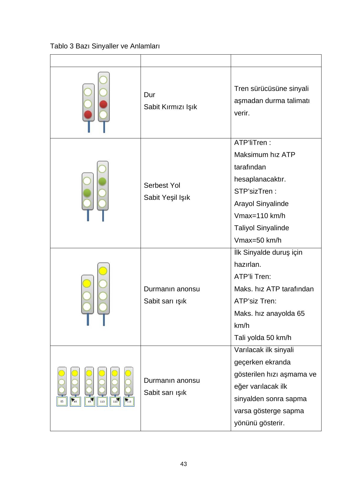

This post is the **signalling section** (22 pages) of a 70-page report from 2014, prepared by a friend for a summer internship at the TCDD YHT Regional Directorate, Facilities Directorate. It covers the ERTMS/ETCS system, on-board and trackside subsystems, balises, signal types, ETCS levels, track circuits, relays and switches. The report's [telecommunications](/arsiv/staj-tcdd-yht-telekomunikasyon-gsm-r-sdh-fiber-optik/) and [electrification](/arsiv/staj-tcdd-yht-elektrifikasyon-katener-sistemi/) sections are in separate posts. Personal details have been removed; the original pages can be downloaded as a PDF at the end of the post.

## B. SIGNALLING

## 4. Signalling Systems

### 4.1. ERTMS System

ERTMS stands for "European Railway Traffic Management System". The basic idea behind ERTMS is to manage all European railway traffic from a single, common centre. In 1993 the ERTMS system was backed by the European Union and the Technical Specifications for Interoperability (TSI) were established. Before ERTMS, each railway administration managed rail traffic with its own ATP system or with several different systems.

The differences in ATP equipment between countries made it difficult for trains to travel safely between countries and added costs in equipment. ERTMS was born from the idea that, by using a common ATP system, trains in Europe could travel easily and safely.

ERTCS: European Train Control System.

### ERTCS Subsystems

- TSS (Trackside System): Trackside System
- OBS (On-board System): On-board System

### 4.1.1.1. OBS Structure

 structure (Figure 27)")

OBS (on-board system) units:

- **DMI (Driver Machine Interface):** Data entry, data validation display and indicators. It is connected to the EVC and shows the information coming from the trackside on the screen.
- **Loudspeaker:** Loudspeaker for audible announcements and warnings; connected to the DMI.
- **Antenna:** Receives data from the balise; connected to the BTM.
- **BTM (Balise Transmission Module):** Checks the telegrams and passes the information to the EVC. It is connected to the EVC and to the BTM antenna.
- **Wheel sensor:** A pulse counter; used for speed and distance evaluation and connected to the EVC.
- **DC/DC converter:** Connected to the locomotive battery at the primary terminals and to the OBS units at the secondary terminals. It supplies the voltage required by the OBS units; input is 72 V, output is 24 V DC.
- **TIU (Train Interface Unit):** Contains the relay arrangement for digital input and output signals; it is where the system relays are located.
- **EVC (European Vital Computer):** Contains the processor, input/output cards, JRU (juridical recorder unit), fan, line filter and capacitor.
- **JRU:** Placed inside the EVC enclosure; it has an external flash memory card for recording data. It has 32 MB of memory and can record for more than a month; distance, date, driving mode and speed information are recorded.

*Figure 27 OBS Structure*

### 4.1.1.2. TSS Trackside System

")

LEU (Line Electronic Unit): There are 2 types of LEU.

- 1 interface balise
- 2 interface balise

### Balises

Balise: The transmission source that conveys ETCS safety information related to signalling and the route. It is a passive element. It is placed between the two rails.

Balise Group: Contains all the information about the signalling status. It is divided into two: the main balise group and the infill balise group.

*Picture 6 Balise*

When grouped by hardware, there are 2 types of balise.

- Fixed Balise
- Variable Balise

When applied in the field, balises are categorised into 4 types:

1. Signal Balise Group (Variable type)

1. Signal Balise Group (Fixed type)

1. Infill Balise (Variable type)

1. Loc Balise (Fixed type)

Each signal has one LEU and at least two balises (one fixed and one variable balise).

Since some signals also have infill balises, such a signal has 3 balises (2 variable and 1 fixed). They are used at entry signals, exit signals and some block signals. Infill balises are variable balises.

### 4.2. Signals

Signals are systems that convey lit, coloured indications to enable trains to proceed. The driver acts on the colour indications given by the signals along the track.

### 4.2.1. Signal Indications

Green light means proceed; yellow light means proceed with caution (it should also be understood as a first warning); red light means absolutely stop. In general, yellow light and its combined colours warn the train to proceed with caution. Green light and its yellow combinations indicate that the train may proceed. Flashing lights give the shunting indication.

### 4.2.2. Signal Types

")

- Signals by appearance
- Two-aspect dwarf colour-light signals
- Three-aspect dwarf colour-light signals
- Three-aspect high colour-light signals
- Four-aspect high signals
- Signals by function
- Entry (home) signals: The entry signals, generally located at both entrances of a station, consist of four-aspect high signals. They can be controlled directly from the centre. The colours are stacked from the bottom upward as yellow, red, green, yellow.
- Exit (starter) signals: Located at both exit sides of the station, on the main line. They are three-aspect high signals, or four-aspect high signals if double-sided. At the exits of side tracks there are three-aspect dwarf signals.
- Block signals: Three-aspect high signals placed on the open line between stations, at the entrance of the blocks. These signals automatically give a colour indication according to the state of the next signal. The distance between blocks is approximately 3 km. On automatic blocks, trains proceed according to the block signals, which give colour indications depending on block occupancy. The colour indications of block signals according to train movements are as follows: o If two blocks are clear, the signal at the block entrance shows green. o If only one block is clear at the exit signals, the block entry signal shows yellow. o If the block at the exit signals is occupied, the block entry signal shows red.
- Approach signals: A controlled block signal located immediately before each station entry signal. Its distance to the entry signal is approximately 1500 metres.
- Protection signals: Protection signals protect the entry sections. These signals give their indications by means of approach boards. They are equipped with only three lamps. Viewed from top to bottom, the order is yellow, green and red. A protection signal shows no more than one colour indication at a time.

### 4.2.3. Alphanumeric Indicator (Speed Indicator)

It shows the passing speed at the signal to be reached after the signal at which it is mounted, and the direction of divergence. The alphanumeric indicator is used on entry signals and protection signals. It gives no indication if the signal on which it is mounted is red.

If the alphanumeric indicator fails, this is detected by the interlocking, and the signal following the signal on which the faulty alphanumeric indicator is mounted is treated as red. In this case ETCS determines the movement authority according to the signal that is treated as red. Alphanumeric indicators are not named independently of the signal at which they are mounted.

*Picture 7 Block Signals*

*Picture 8 Approach Signals*

*Picture 9 Three-Aspect Dwarf Signal*

*Picture 10 Two-Aspect Dwarf Signal*

*Picture 11 Four-Aspect High Signal*

### 4.2.4. Signal Indications

| Signal indication | Meaning / speed |
| --- | --- |
| **Stop** (steady red light) | Instructs the train driver to stop without passing the signal. |
| **Clear** (steady green light) | ATP-equipped train: the ATP calculates the maximum speed. Train without ATP: Vmax = 110 km/h at a main-line signal, Vmax = 50 km/h at a secondary-line signal. |
| **Stop warning** (steady yellow light) | Prepare to stop at the first signal. ATP-equipped train: the ATP determines the maximum speed. Train without ATP: at most 65 km/h on the main line, 50 km/h on the secondary line. |
| **Stop warning** (steady yellow light, with speed indicator: 65, 110, with divergence arrows) | Do not exceed the speed shown on the display when passing the first signal reached; if there is a divergence after the first signal reached, the indicator shows the direction of divergence. |
| **Divergence warning** (steady yellow and green light) | Announcement that the signal to be reached is clear. ATP-equipped train: the ATP determines the maximum speed. Train without ATP: at most 110 km/h on the main line. |
| **Yellow signal warning** (flashing green) | ATP-equipped train: the ATP determines the maximum speed (Vmax = 250 km/h). Train without ATP: Vmax = 110 km/h at a main-line signal. |

*Table 3: Some signals and their meanings (transcribed from the report's table into text; see the page image above for the light arrangements).*

I examined the distance between the Signal Balise Group and the signal, the distance between the Infill Balise and the signal, and how far away the infill balises must be placed for the Entry Signal, Exit Signal and Block Signal.

### 4.2.5. Signal Balise Distances

")

Distance between the Signal Balise Group and the signal:

- The variable balise of the signal balise group is 16.2 m from the signal. Distance between the infill balise and the signal:
- 300 m for the entry signal.
- 200 m for the exit signal.
- 1000 m for the block signal.

*Figure 28 Signal Balise Distances*

### 4.3. ETCS Levels

Signalling on the track (lineside signals):

- Level 0: Maximum speed supervision for the transition position
- Level STM: Also compatible with the existing line infrastructure.
Signalling in the train cab:

- Level 1: Balises act as spot information points. Lineside signalling is needed only when the train starts moving.
- Level 2: There is continuous information transmission. Blocks are used. Lineside signalling is not required.
- Level 3: There is continuous information transmission. It guarantees train integrity. Lineside signalling is not required.

### 4.3.1. Level 0

")

- Takes place in lineside signalling.
- Maximum speed supervision applies.
- The driver is responsible for train safety.
- Train detection and integration are carried out by track circuits.

*Figure 30 Level 0 ETCS System*

### 4.3.2. Level 1

- Takes place in cab signalling.
- Euro balises (fixed and variable).
- Spot transmission with continuous supervision.
- Interlocking/route control is performed.
- Infill information is preferably provided via Eurobalise or Euroloop.
- Train detection and integration are carried out by track circuits.

*Figure 31 Level 1 ETCS System*

### 4.3.3. Level 2

- Takes place in cab signalling.
- Eurobalises serve for odometry calibration and repositioning.
- Continuous information is provided.
- There is continuous transmission and supervision.
- Train detection and integration are carried out by track circuits.

*Figure 32 Level 2 ETCS System*

### 4.3.4. Level 3

- There is continuous transmission and supervision.
- Train positioning is carried out from on board the train.
- There is no track monitoring.
- Train headways are managed by the ATP/ATC system. 4.4.

### Track Circuits

A track circuit can also be defined as an electrical circuit of which the rails form a part. The energy source of a track circuit may be direct current taken from a battery, or alternating current at a suitable frequency. The main function of the track circuit is to detect the presence of trains and report it to the following trains.

### 4.4.1. Track Circuits by Type

- DC Track Circuits: A track circuit with a direct-current battery as the supply source, applied over a length of 1800 m, with a 0.5 Ω or 1 Ω polarised relay at the far end. The other two important elements of the circuit are the protection resistor on the battery side and the voltage-adjusting resistor on the relay side.
- AC Track Circuits: On electrified line sections, the return current of the catenary voltage also flows through the rail, so signalling between stations with direct-current track circuits is not possible in these sections. For this reason, alternating-current track circuits must be used, especially between stations. AC track circuits may also be used on station tracks and in switch areas. There are two types of alternating-current circuit: end-fed and centre-fed.

### 4.4.2. Track Circuits by Feed Arrangement

- End-fed: Consists of one battery and one relay.
- Centre-fed: Consists of a battery at the centre and relays at the ends.
- End-fed (two relays): Consists of a battery at one end and two relays located at the ends.

### 4.4.3. Track Circuits by Characteristics

- Coded Track Circuits: Direct-current and alternating-current track circuits can also be used in coded form. The code rates are 75, 120 and 180 per minute. Using alternating current in coded form is essential, especially to protect electrification systems from the effects of any induced voltages.
- Jointless Track Circuits: The supply is AC. Insulated joints are not used on the lines. Before one supply voltage ends, at a certain distance, the next supply voltage and the relay of the next track circuit begin.

### 4.5. End-Fed DC Track Circuit

")

The track section is fed by a 1.5 V, 100 A·h battery, and at the other end of the track section there is a resistor, in series and parallel with the circuit, that monitors this track. The sum of all these track resistances is 2 ohms under normal conditions. Because of these resistances at each sleeper from the feed point onward, there will be a voltage drop: the battery output (connection point) fed at 1.25 V from the end point will drop to 0.5–0.6 V at the relay terminals. The pick-up current of the track relay is a minimum of 240 mA, and the pick-up voltage of the relay is V = I×R, 0.24×1 = 240 mV. This ballast resistance falls for reasons such as the track being left in flood mud or the ballast quality deteriorating, and these causes make the relay drop. Since this makes it appear as if there is a train in the track section, it will cause a false-occupancy fault. When a train enters the track section it short-circuits the line and the relay drops. Through the relay contacts, the train is seen between stations at the control centres. This causes the signals controlling this block to turn red. The relay drop test is performed by short-circuiting the rail with a 0.06 ohm wire or shunt file.

*Figure 33 End-Fed DC Track Circuit*

### 4.6. Relays

A relay is a component that, with the electromagnetic field produced by a small current, controls one or more groups of switches so as to operate a load working at high power and high current. In short, it allows larger currents and voltages to be controlled with small currents and voltages. Relays can also switch without being affected by different frequencies and waveforms, and can thus control electrical and electronic circuits of very different characteristics. Although their field of use has narrowed since the production of semiconductor-based thyristors and triacs, relays are still used in applications that require control of very high currents and voltages. Their advantage over thyristors and triacs is that a single relay can have more than one switch or contact, so it can switch more than one load on or off at the same time. It can even switch some loads on and others off at the same time. This depends entirely on how the relay's contacts are connected.

Relays must be used in environments of high temperature, humidity or liquids where electronic circuits cannot operate, and sometimes in air and fluid control systems.

We can mention the problems encountered in relay applications. Because they operate mechanically, the electrical environments they produce cause the contacts to oxidise over time and lose conduction. The switching-on time is longer. In addition, the noise made when the contacts pull in and release is not very pleasant. The coils of relays, generally supplied with a voltage between 5 V and 48 V, draw a current between 5 mA and 150 mA. Their contacts can withstand current values between 0.5 A and 70 A. In application circuits, a wide coil supply voltage range is convenient. This makes it possible to drive them with both logic and analogue circuits.

The structure and operation of relays differ according to their type. The structure and operation of each type will be described as the relay types are explained. In general, however, it can be said that in all relays an effect makes the contacts change position, and a circuit is controlled by making use of this change.

### Relay Types

Relays can be classified as magnetic relays, vertical-contact relays, thermal relays and overcurrent protection relays.

### 4.6.1.1. Magnetic Relays

")

A current flowing through a conductor wire coated with an insulating layer and wound around an iron rod creates a magnetic field that attracts nearby metals. Magnetic relays are made by exploiting this property of current.

Magnetic relays consist of three basic parts: the relay coil, the relay contacts and the armature. The coil consists of a large number of turns of conductor wire wound on a plastic sleeve fitted over an iron core made in the shape of a cylinder or rectangular prism. The armature is the soft-iron part that moves under the influence of the coil's magnetic field. Soft iron is chosen as the core because it easily acquires a magnetic field and just as easily loses it. At the point where the armature touches the contacts there is an insulating material called fibre. When there is no magnetic field, it is held under tension by a spring. The contacts are good conductors that allow current to flow when they touch each other. In addition, a relay has an insulating base material that prevents unintended contact between the contacts.

The coil and core work like an electromagnet. When voltage is applied to the coil terminals, it creates a magnetic field and pulls the armature toward itself. As a result of this movement of the armature, the normally closed contacts open. If a load is connected to the terminals of these contacts, it will stop working. And the load connected to these contact terminals will operate. Magnetic relays are classified according to the number and type of contacts on them. A single-contact, single-position relay has a single switch, and there is no other switch working opposite to it. It serves only to switch one load on and off. A single-contact, double-position relay, on the other hand, operates one load while stopping another as its switch changes position. Similarly, multi-contact relays can be obtained by increasing the number of contacts working in parallel in the relay.

*Figure 34 Internal structure of a DC-voltage magnetic relay*

### 4.6.1.2. Reed Relays

A relay made by placing metal contacts that are easily affected by a magnetic field inside an evacuated glass tube is called a reed contact; if it has many contacts, it is called a reed relay. Reed contacts have many uses, such as liquid-level control, underwater devices, remote-control switches and car warning lights.

In reed relays, bringing a magnet close or passing current through a coil wound around the glass envelope is enough to close the contact. Reed contacts are magnetic-field-controlled switches. The opening and closing of the switch depends on changes in the magnetic field.

*Figure 35 Reed Relay*

### 4.6.1.3. Thermal Relays

This is a type of relay that opens or closes its contacts according to changes in ambient temperature. Thermal relays are frequently used to stop motors that overheat during operation, and in heat-generating appliances such as irons and hair dryers to prevent further heating once the appropriate temperature level is reached.

Thanks to a special metal combination inside thermal relays called a bimetal, the current to the load is cut off when the ambient temperature rises above a set value. A bimetal consists of two metals that expand differently under heat. One metal expands quickly and a lot while the other expands very little, causing the bimetal to bend in one direction and thereby converting heat energy into motion energy. This motion energy is used to close the contacts. Thermal relays can have many different constructions. Thermal relays used in motor control circuits contain a chrome-nickel heater that produces the heating, whereas thermal relays used in irons and similar appliances use the heat inside the appliance and contain only a bimetal and contacts.

*Figure 36 Single-Contact, Single-Position Externally Heated Thermal Relay*

The internal structure of these two different thermal relays is shown in the figure. In the first relay, the bimetal bends onto the armature under the effect of heat and makes the contacts move. In the second relay, the bimetal, loosened by the effect of heat, falls onto the contact under its own weight and causes the contact to open.

### 4.6.1.4. Overcurrent Protection Relays

")

Because of their operating characteristics, fuses placed at the head of a line in a load circuit protect the line, not the load. Various relays are used to protect loads before a fault occurs. The overcurrent relay is used to prevent the damage that excessive currents would do to motor windings. Overcurrent protection relays are designed to protect motors and systems against overcurrent.

Overcurrent relays, connected to only one conductor in single-phase AC circuits and to all three phase conductors in three-phase circuits, control the normally closed contact connected in series in the control circuit. In overcurrent relays, the current setting is made with the adjustment screw on the relay. The current is set within certain limits according to the rated currents of the motors.

Overcurrent relays are connected in series with the load circuit and the load current flows through them. The windings are not damaged by short-duration overcurrents drawn by the load because of a temporary fault or at the moment of starting, and in this case the relay is not expected to open the circuit. For this reason, the relay is prevented from opening the circuit immediately by a delay system. If the current value is within normal limits, the output relay is in the picked-up position. If the current rises above the set value, the output relay drops its contact at the end of the delay time and takes the motor or system connected to it out of the circuit.

I learned about switches (points), switch types, point machines and their characteristics and functions.

### 4.7. Switches (Points)

")

A switch (set of points) is an installation made up of movable and fixed parts that allows railway vehicles to pass from one track to another.

The most important difference between railway vehicles and road vehicles is that they have no steering. For this reason, the passage of railway vehicles from one track to another is achieved by means of switches laid on the tracks.

Remotely controlled switches are equipped with electric motors. In CTC line sections, these are switches that can be controlled electrically from the controller's control centre or the station control panel. By type, switches are as follows.

- Reversible (Double-Direction) Switches: The train can enter and leave the switch from both directions. The use of this type of switch is preferred at stations called terminals, where there are many manoeuvres. Their pressing and pulling forces on the rail are lower than those of the other types.
- Non-Reversible (Single-Direction) Switches: This type of switch is also used on main lines. The train passes over it in one direction only. Their rail pushing and pulling forces are very high.

### 4.7.1. Characteristics of Point Machines

The most important factor enabling remote control of switches is the electric motors operating within this system. Generally, motors running on direct current are used in the switch system. These motors can be run in two directions at 26 V DC. With the mechanism installed, the direction of the voltage applied to the motor can be reversed. In this way, the motor is run in both directions. These motors are supplied by batteries prepared at 26 V DC. They must be able to provide the thrust required for the switch blades to move from one stock rail to the other stock rail in the shortest possible time. In addition, point machines monitor blade openings of 2 to 3 mm. That is, the switch lock locks below 2 mm, does not lock from 3 mm upward, and sends an alarm to the centre.

*Picture 12 View of a Railway Switch*

*Figure 38 Parts That Make Up a Switch*

*Picture 13 Giving Direction at Switches*
