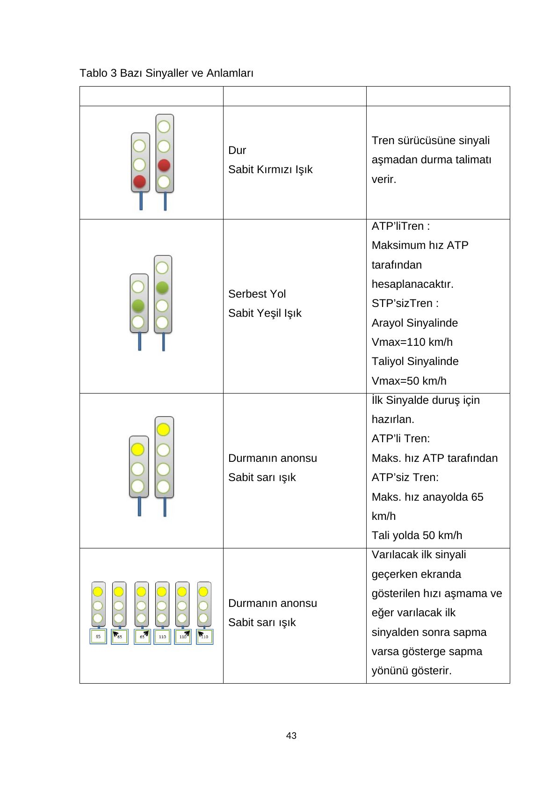

Bu yazı, TCDD YHT Bölge Müdürlüğü Tesisler Müdürlüğü yaz stajı için bir arkadaşın hazırladığı 2014 tarihli, 70 sayfalık raporunun **sinyalizasyon bölümüdür** (22 sayfa): ERTMS/ETCS sistemi, araç üstü ve yol boyu alt sistemler, balizler, sinyal tipleri, ETCS seviyeleri, ray devreleri, röleler ve makaslar. Raporun [telekomünikasyon](/arsiv/staj-tcdd-yht-telekomunikasyon-gsm-r-sdh-fiber-optik/) ve [elektrifikasyon](/arsiv/staj-tcdd-yht-elektrifikasyon-katener-sistemi/) bölümleri ayrı yazılarda. Kişisel bilgiler çıkarılmıştır; orijinal sayfalar yazının sonunda PDF olarak indirilebilir.

## B. SİNYALİZASYON

## 4. Sinyalizasyon Sistemleri

### 4.1. ERTMS Sistemi

ERTMS kısaltması “EuropeanRailwayTraffic Management System” ‘i ifade etmekte olup Avrupa Demiryolu Trafik Yönetim Sistemi olarak Türkçe’ye çevrilmektedir. ERTMS için temel fikir tüm Avrupa demiryolu trafiğini aynı ve tek bir merkezden yönetmektir. 1993’te ERTMS sistmei Avrupa Birliği tarafından desteklenmiş olup ortak işletilebilirlik Talimatları (TSI) oluşturulmuştur. ERTMS çıkmadan önce her Demiryolu Müdürlüğü demiryolu trafiğini kendi ATP sistemiyle veya birkaç değişik sistemle yönetiyordu.

Ülkeler arasındaki ATP ekipmanlarının farklı olması ülkeler arasında trenlerin güvenli seyahatini zorlaştırıyor ve donatımda maliyetler getiriyordu. ERTMS, ortak bir ATP sistemi kullanarak Avrupa’daki trenlerin seyahatlerinin kolay ve güvenli olabileceği fikriyle doğmuştur.

ERTCS: European Train Control System.

### ERTCS Alt Sistemleri

- TSS (TracksideSystem): Yol boyu Sistemi
- OBS (On board System): Araç üstü Sistemi

### 4.1.1.1. OBS Yapısı

 yapısı (Şekil 27)")

OBS (araç üstü sistem) birimleri:

- **DMI (Sürücü Makine Arayüzü):** Veri girişi, veri doğrulama ekranı ve göstergeler. EVC'ye bağlıdır; sahadan gelen bilgileri ekranda gösterir.
- **Hoparlör:** Sesli anons ve uyarı hoparlörü; DMI'ye bağlıdır.
- **Anten:** Balizden veri alır; BTM'ye bağlıdır.
- **BTM (Baliz İletim Modülü):** Telgramları kontrol eder ve bilgileri EVC'ye iletir. EVC'ye ve BTM antenine bağlıdır.
- **Tekerlek sensörü:** Bir darbe sayacıdır; hız ve mesafe değerlendirmesi için kullanılır, EVC'ye bağlıdır.
- **DC/DC konvertör:** Primer kelepçelerde lokomotif bataryasına, sekonder kelepçelerde OBS ünitelerine bağlıdır. OBS üniteleri için gerekli gerilimi sağlar; giriş 72 V, çıkış 24 V DC'dir.
- **TIU (Tren Arayüz Ünitesi):** Dijital giriş ve çıkış sinyalleri için röle tertibatı bulundurur; sistem rölelerinin bulunduğu yerdir.
- **EVC (Avrupa Hayati Bilgisayar):** İşlemci, giriş/çıkış kartları, JRU (adli kayıt cihazı), fan, hat filtresi ve kapasitör içerir.
- **JRU:** EVC muhafazasının içine yerleştirilmiştir; verilerin kaydedilmesi için harici flaş bellek kartı vardır. 32 MB hafızası vardır, bir aydan fazla süre kayıt yapabilir; mesafe, tarih, sürüş modu ve hız bilgileri kaydedilir.

*Şekil 27 OBS Yapısı*

### 4.1.1.2. TSS Yol Boyu Sistemi

")

LEU (Line Electronic Unit): 2 tip LEU vardır.

- 1 interface baliz
- 2 interface baliz

### Balizler

Baliz: Sinyalizasyon ve güzergahla ilgili ETCS güvenlik bilgisini ileten iletim kaynağıdır. Pzsif elemandır. İki ray arasına yerleştirilir.

Baliz Grubu: Sinyalizasyon durumu hakkında bütün bilgiler bulunur. Ana baliz grubu ve infill baliz grubu olmak üzere ikiye ayrılır.

*Resim 6 Baliz*

Donanım olarak gruplandırıldığında 2 tip baliz vardır.

- Fix Baliz (Sabit Baliz)
- Variable Baliz (Değişken Baliz)

Balizler sahaya uygulandığında 4 tip olarak kategorize edilir:

1. Sinyal Baliz Grubu (Variable tip)

1. Sinyal Baliz Grubu (Fix Tip)

1. Infill Baliz (Variable Tip)

1. Loc Baliz (Fix Tip)

Her bir sinyale ait bir tane LEU ve en az iki tane baliz (1 fix ve 1 değişken balizden oluşur) vardır.

Bazı sinyallerin infillbalizleri de olduğu için, o sinyale ait 3 tane baliz vardır. (2 variable ve 1 fix) giriş, çıkış sinyalleri ve bazı blok sinyallerinde kullanılır. İnfillBalizlervariablebalizlerdir.

### 4.2. Sinyaller

Trenlerin ilerlemesini sağlayan ışıklı, renkli bildirim veren sistemlerdir. Makinist yol boyunca bulunan sinyallerin verdiği renk bildirimlerine göre hareket eder.

### 4.2.1. Sinyal Bildirimleri

Yeşil Işık; ilerle, sarı ışık; kontrollü ilerle (ilk ikaz olarak da algılanmalıdır.) Kırmızı ışık, kesinlikle dur anlamındadır. Genelde sarı ışık ve kombine renkleri trenin kontrollü ilerlemesini ikaz eder. Yeşil ışık ve sarı kombinasyonları ise ilerlemeyi bildirir. Yanar söner ışıklarsa manevra bildirimini verir.

### 4.2.2. Sinyal Tipleri

")

- Görünüşlerine göre Sinyaller
- İkili Cüce Renkli Sinyaller
- Üçlü Cüce Renkli Sinyaller
- Üçlü Yüksek Renkli Sinyaller
- Dörtlü Yüksek Sinyaller
- Fonksiyonlarına göre Sinyaller
- Giriş Sinyalleri: Genelde istasyonun her iki girişinde bulunan giriş sinyalleri dörtlü yüksek sinyallerden oluşmuştur. Merkezden direk kumanda edilebilirler. Alttan itibaren sarı, kırmızı, yeşil, sarı renkler üst üste dizilmiştir.
- Çıkış Sinyalleri: İstasyonun her iki çıkış tarafında bulunur. Ana hat üzerindedir. Üç renkli yüksek, çift taraflı ise dört renkli yüksek sinyallerdir. Yan yolların çıkışlarında ise üç renkli cüce sinyaller bulunur.
- Blok Sinyalleri: İstasyonlar arasında açık hatta bulunan, blokların girişine konmuş olan üçlü yüksek sinyallerdir. Bu sinyaller kendinden bir sonraki sinyalin durumuna göre otomatik olarak renk bildirisi verir. Bloklar arası mesafe yaklaşık 3 km’dir. Otomatik bloklarda ilerleyen trenler, blokların meşguliyetlerine göre renk bildirisi veren blok sinyallerine göre ilerlerler. Blok sinyallerin tren hareketlerine göre renk bildirileri; o İki blok boşsa giriş bloktaki sinyal yeşil yanar. o Çıkış sinyalleri tek blok boşsa blok giriş sinyali sarı yanar. o Çıkış sinyalleri blok doluysa blok giriş sinyali kırmızı yanar.
- Yaklaşma Sinyalleri: Her istasyon giriş sinyalinin bir öncesinde bulunan kumandalı blok sinyaldir. Yaklaşık giriş sinyaline uzaklığı 1500 metredir.
- Koruma Sinyalleri: Koruma sinyalleri giriş kesimlerini korurlar. Bu sinyaller yaklaşma levhaları ile bildirirler. Sadece üç lamba ile teçhiz edilmiştir. Yukarıdan aşağıya bakıldığında sıralaması: Sarı, yeşil ve kırmızıdır. Koruma sinyalinde aynı anda an fazla bir renk bildirisi olur.

### 4.2.3. Alfa nümerik Gösterge (Hız Göstergesi)

Monte edildiği yerdeki sinyalden sonra varılacak olan sinyalden geçiş hızını ve sapma yönünü gösterir. Alfa nümerik gösterge giriş sinyallerinde ve koruma sinyallerinde kullanılır. Monte edildiği sinyalin kırmızı olması durumunda bildiri vermez.

Alfa nümerik gösterge arızalanmış ise bu durum anklaşman tarafından tespit edilir ve arızalı alfa nümerik göstergenin monte edildiği sinyalden sonraki sinyal kırmızı olarak değerlendirilir. Bu durumda ETCS hareket yetkisini kırmızı olarak değerlendirilen sinyale göre belirler. Alfa nümerik göstergeler monte edildiği yerdeki sinyalden bağımsız bir şekilde adlandırılmazlar.

*Resim 7 Blok Sinyalleri*

*Resim 8 Yaklaşım Sinyalleri*

*Resim 9 Üçlü Cüce Sinyali*

*Resim 10 İkili Cüce Sinyali*

*Resim 11 Dört Renkli Yüksek Sinyal*

### 4.2.4. Sinyal Bildirimleri

| Sinyal bildirimi | Anlamı / hız |
| --- | --- |
| **Dur** (sabit kırmızı ışık) | Tren sürücüsüne sinyali aşmadan durma talimatı verir. |
| **Serbest yol** (sabit yeşil ışık) | ATP'li tren: azami hızı ATP hesaplar. ATP'siz tren: ana yol sinyalinde Vmax = 110 km/h, tali yol sinyalinde Vmax = 50 km/h. |
| **Durmanın anonsu** (sabit sarı ışık) | İlk sinyalde duruşa hazırlan. ATP'li tren: azami hızı ATP belirler. ATP'siz tren: ana yolda en çok 65 km/h, tali yolda 50 km/h. |
| **Durmanın anonsu** (sabit sarı ışık, hız göstergeli: 65, 110, sapma okları ile) | Varılacak ilk sinyali geçerken ekranda gösterilen hızı aşmama; varılacak ilk sinyalden sonra sapma varsa gösterge sapma yönünü gösterir. |
| **Sapma anonsu** (sabit sarı ve yeşil ışık) | Varılacak sinyalin açık olduğunun anonsu. ATP'li tren: azami hızı ATP belirler. ATP'siz tren: ana yolda en çok 110 km/h. |
| **Sarı sinyal anonsu** (yanar-söner yeşil) | ATP'li tren: azami hızı ATP belirler (Vmax = 250 km/h). ATP'siz tren: ana yol sinyalinde Vmax = 110 km/h. |

*Tablo 3: Bazı sinyaller ve anlamları (raporun tablosundan metne aktarıldı; ışık düzenleri için yukarıdaki sayfa görseline bakın).*

Sinyal Baliz Grubu ile Sinyal arasındaki mesafe, İnfill Baliz ile Sinyal arasındaki mesafeleri ve Giriş Sinyali, Çıkış Sinyali ve Blok Sinyali için İnfill Balizlerin ne kadar mesafelere yerleştirilmesi gerektiğini inceledim.

### 4.2.5. Sinyal Baliz Mesafeleri

")

Sinyal Baliz Grubu ille Sinyal arasındaki mesafe;

- Sinyal baliz grubu variable baliz sinyalden 16,2 m mesafededir. İnfill Baliz ile sinyal arasındaki mesafe;
- Giriş sinyali için 300 m.
- Çıkış sinyali için 200 m.
- Blok sinyali için 1000 m.

*Şekil 28 Sinyal Baliz Mesafeleri*

### 4.3. ETCS Seviyeleri

Yoldaki sinyalizasyon (hat boyu sinyaller):

- Seviye 0: Geçiş konumu için maksimum hız denetimi
- Seviye STM: Var olan hat altyapısı ile de uyumludur.
Tren kabinindeki sinyalizasyon:

- Seviye 1: Balizler dakik bilgi görevi görür. Hat boyu sinyalizasyonuna sadece trenin hareketinin başlamasında ihtiyaç duyulur.
- Seviye 2: Sürekli bilgi iletimi vardır. Bloklar kullanılır. Hat boyu sinyalizasyona gerek yoktur.
- Seviye 3: Sürekli bilgi iletimi vardır. Tren bütünlüğünü garanti eder. Hat boyu sinyalizasyonuna gerek yoktur.

### 4.3.1. Seviye 0

")

- Hat boyu sinyalizasyonda yer alır.
- Maksimum hız denetimi geçerlidir.
- Tren güvenliğinden sürücü sorumludur.
- Ray devresi ile tren tespiti ve entegrasyonu gerçekleştirilir. 

*Şekil 30 Seviye 0 ETCS Sistemi*

### 4.3.2. Seviye 1

- Tren kabinindeki sinyalizasyonda yer alır.
- Avro balizler (sabit ve değişken)
- Noktasal aktarım, sürekli denetim söz konusudur.
- Ankleşman/güzergah kontrolü yapılır.
- Tercihen eurobalize veya euroloop aracılığı ile infill bilgisi verilir.
- Ray devresi ile tren tespiti ve entegrasyonu gerçekleştirilir.

*Şekil 31 Seviye 1 ETCS Sistemi*

### 4.3.3. Seviye 2

- Tren kabinindeki sinyalizasyonda yer alır.
- Eurobalizlerodometri ayarlanması ve yeniden konumlandırma görevi görür.
- Sürekli bilgi söz konusudur.
- Sürekli aktarım ve denetim vardır.
- Ray devresi ile tren tespiti ve entegrasyonu gerçekleştirilir.

*Şekil 32 Seviye 2 ETCS Sistemi*

### 4.3.4. Seviye 3

- Sürekli aktarım ve denetim vardır.
- Trenlerin konumlandırılması araç üstünden yapılır.
- Yol izleme yoktur.
- Tren aralıkları ATP/ATC sistemi ile yapılır. 4.4.

### Ray Devreleri

Ray devrelerini, bir kısmını rayların oluşturduğu elektrik devresi olarak da tanımlayabiliriz. Ray devresinde enerji kaynağı bir bataryadan alınan doğru akım yada uygun frekansta alternatif akım olabilir. Ray devresinin asıl fonksiyonu trenlerin varlığını kontrol etmek ve takip eden trenlere bildirmektir.

### 4.4.1. Niteliklerine Göre Ray Devreleri

- DC Ray Devreleri: Besleme kaynağı bir doğru akım bataryası olan ve 1800 m uzunluğundaki bir ray devresinde tatbik olunan, karşı ucunda 0,5 Ω veya 1 Ω’luk polarize röleden oluşan bir ray devresidir. Devrenin diğer iki önemli elemanı batarya tarafındaki koruma direnci ile röle tarafındaki gerilim ayar direncidir.
- AC Ray Devreleri: Elektrifikasyon uygulanan hat kesimlerinde raydan aynı zamanda katener gerilimine ait dönüş akımının da geçmesi söz konusu olduğundan bu kesimlerde istasyonlar arasının doğru akım ray devreleriyle sinyallenmesi mümkün değildir. Bunun için özellikle istasyonlar arasında alternatif akım ray devreleri kullanılması zorunludur. İstasyon yolları ve makas bölgelerinde de alternatif akım ray devreleri kullanılabilir. Alternatif akımın uçtan ve ortadan beslemeli iki tipi vardır.

### 4.4.2. Besleme Şekillerine Göre Ray Devreleri

- Uçtan Beslemeli: Bir batarya ve bir röleden oluşur.
- Ortadan Beslemeli: Ortadan bir batarya ve uçlarında bulunan rölelerden oluşur.
- Uçtan Beslemeli (İki Röleli): Bir uçtaki bataryadan ve uçlarda bulunan iki röleden oluşur.

### 4.4.3. Özelliklerine Göre Ray Devreleri

- Kodlu Ray Devreleri: Doğru akım ve alternatif akım ray devreleri kodlu olarak da kullanılabilmektedir. Kod sayıları dakikada 75, 120 ve 180 dir. Özellikle alternatif akımın kodlanarak kullanılması elektrifikasyon sistemlerini herhangi bir şekilde indüklenen gerilimlerinin etkisinden korumak için zorunludur.
- Eksiz Ray Devreleri Besleme AC’dir. Hatlarda izole cebire kullanılmamaktadır. Bir besleme geriliminin bitmesinde belirli bir mesafeden önce diğer besleme gerilimi ve diğer ray devresinin rölesi başlar.

### 4.5. Uçtan Beslemeli DC Ray Devresi

")

Hat kısmı 1,5 V 100 A.h bir akü ile beslenmekte ve hat bölgesinin diğer ucunda ise bu hattı kontrol eden bu devreye seri ve paralel olarak bir direnç bulunmaktadır. Bütün bu hat dirençlarinin toplamı normal şartlarda 2 ohm’dur. Besleme noktasından itibaren her travestte bulunan bu dirençlerden dolayı bir gerilim düşümü olacak, uç noktadan 1,25 V ile beslenen batarya bootleg (bağlantı noktası) çıkışı, röle bootleginde 0,5~0,6 V’a düşecektir. Track rölesinin çekme akımı minimum 240 mAolup rölenin çekme voltajı V=IxR, 0,24x1=240 mVolacaktır.bu belirtilen balast direnci yolun sel çamur içinde kalması balast kalitesinin düşmesi gibi nedenlerden dolayı düşmekte ve bu nedenler rölenin düşmesine sebep olur. Bu ise track bölgesinde tren varmış gibi gözükeceğinden yön arızasına neden olacaktır. Tren track bölgesine basınca hattı kısa devre yapar, röle düşer. Rölenin kontaklarından kumanda merkezlerinde istasyon aralarında tren görülür. Bu bloğu kontrol eden sinyallerin kırmızı renge dönüşmesine neden olur. Rölenin düşme testi ise 0,06 ohmluk tel veya şönt eğe ile ray kısa devre yapılarak bulunur.

*Şekil 33 Uçtan Beslemeli DC Ray Devresi*

### 4.6. Röleler

Küçük değerli bir akımın oluşturduğu elektromanyetik alan ile yüksek güçte ve yakımda çalışan bir alıcıyı çalıştırabilmek için bir yada daha fazla anahtar grubunu kontrol eden elemana röle denir. Özetle küçük akım ve gerilimlerle daha büyük akım ve gerilimlerin kontrolünü sağlar. Röleler aynı zamanda farklı frekans ve dalga türlerinden de etkilenmeden anahtarlama yaparak çok farklı özellikteki elektrik ve elektronik devrelerin kontrolünü yapabilmektedir. Yarı iletken esasına dayalı olarak çalışan tristör ve triyakların üretilmesinden sonra kullanım alanı daralan röleler yine de de çok yüksek akım ve gerilim kontrolü gerektiren uygulamalarda halen kullanılmaktadır. Tristör ve tiryaklara göre avantajı, tek bir röle içinde birden fazla anahtar veya kontağa sahip olabildiği için birden fazla yükü aynı anda açabilir veya kapatabilir. Hatta aynı anda bazı yükleri açıp bazılarını kapatabilir. Bu işlem tamamen rölenin kontaklarının bağlanma şekline bağlıdır.

Röleler elektronik devrelerin giremediği yüksek ısı, nem veya sıvı ortamları bazen hava ve sıvı kontrol sistemlerinde mutlaka kullanılmak zorundadır.

Röle uygulamalarında karşılaşılan problemlerden bahsedebiliriz. Mekanik olarak çalıştığı için oluşan elektronik ortamları zamanla kontakların oksitlenmesine ve iletimini kaybetmesine neden olur. İletime geçme süresi daha uzundur. Ayrıca kontakların çekip bırakmasında çıkarmış olduğu ses pek de hoş değildir. Rölelerin genel olarak 5 V-48 V arasında gerilim ile beslenen bobinleri, 5 mA-150 mA arasında akım çekmektedir. Kontakları ise 0,5 A-70 A arasında akım değerlerine dayanabilmektedir. Uygulama devrelerinde bobin besleme gerilimi aralığının geniş olması kolaylık sağlamaktadır. Bu sayede hem lojistik hem de analog devreler ile sürülmesi sağlanmaktadır.

Rölelerin yapısı ve çalışması türüne göre farklılık göstermektedir. Röle türleri anlatılırken her türlü çalışmasında ve yapısında bahsedilecektir. Ancak genel olarak tüm röleler için bir etki ile kontakların yer değiştiği ve bu değişimden faydalanarak bir devrenin kontrol edildiği söylenebilir.

### Röle Çeşitleri

Röleler manyetik röleler, dik kontak, termik röleler, aşırı akım koruma röleleri olarak çeşitlendirilebilir.

### 4.6.1.1. Manyetik Röleler

")

Bir demir çubuğun etrafına sarılmış yalıtkan yüzey ile kaplanmış bir iletken telden geçen akım bir manyetik alan oluşturarak yakındaki metalleri kendine doğru çeker. Akımın bu özelliğinden faydalanarak manyetik röleler üretilmiştir.

Manyetik röleler üç temel kısımdan oluşur. Bunlar röle bobini, röle kontakları ve palettir. Bobin silindirik veya dikdörtgen prizma şeklinde imal edilen bir demir nüve üzerine geçirilmiş bir plastik kılıfa çık sayıda sarılmış iletken telden oluşur. Paletler ise bobinin manyetik alanından etkilenerek hareketlenen yumuşak demir parçasıdır. Nüve olarak yumuşak demir seçilmesinin nedeni kolay manyetik alan kazanırken bu özelliğini kolayca kaybetmesidir. Paletin kontaklara temas ettiği noktada fiber adı verilen bir yalıtkan madde vardır. Manyetik alan olmadığında bir yay ile gergide tutulur. Kontaklar ise birbirlerine temas ettiğinde akım akmasına izin veren iyi iletken malzemelerdir. Bir rölede bunların dışında kontakların istek dışı temasını engelleyen yalıtkan bir zemin maddesi bulunur.

Bobin ve nüve elektromıknatıs gibi çalışır. Bobin uçlarına gerilim verildiğinde bir manyetik alan oluşturarak paleti kendine doğru çeker. Paletin bu hareketi sonucu normalde kapalı olan kontaklar açılır. Eğer bu kontakların uçlarına bir yük bağlanmışsa çalışması duracaktır. Ve bu kontak uçlarına bağlı olan yük çalışacaktır. Manyetik röleler üzerinde bulunan kontak sayısı ve çeşidine göre sınıflandırılırlar. Tek kontaklı ve tek konumlu röle üzerinde tek bir anahtar vardır. Ve bu anahtara ters çalışan bir başka anahtar yoktur. Sadece bir yükün açılıp kapanmasına yarar. Tek kontak çift konumlu röleler ise üzerinde bulundurduğu anahtarın konum değiştirmesi sonucu bir yükü çalıştırırken diğerini durdurur. Benzer şekilde röledeki paralel çalışan kontak sayısı artırılıp çok kontaklı röleler elde edilebilir.

*Şekil 34 DC gerilimle çalışan manyetik rölenin iç yapısı*

### 4.6.1.2. Dil Kontak Röleler

Havası alınmış bir cam tüp içine manyetik alandan kolayca etkilenen metal kontakların yerleştirilmesi ile yapılan röleye dil kontak, kontak sayısı fazla ise dil kontak rölesi denir. Dil kontakların sıvı seviye kontrol, su altında çalışan cihazlarda, uzaktan kontrol anahtarı ve otomobillerin uyarı ışıkları gibi birçok kullanım alanları vardır.

Dil kontaklı rölelerde kontağın kapanması için bir mıknatıs yaklaştırmak veya cam kılıf üzerine sarılan bobin üzerinden akım geçirmek yeterlidir. Dil kontaklar manyetik alan kontrollü anahtardır. Anahtarın açılıp kapanması ise manyetik alan değişimine bağlıdır.

*Şekil 35 Dil Kontak Rölesi*

### 4.6.1.3. Termik Röleler

Ortamdaki ısı değişikliğine göre kontaklarını açan ya da kapayan röle türüdür. Termik röleler çalışma sırasında aşırı ısınan motorların durdurulmasında veya ütü, saç kurutma makineleri gibi ısı üreten cihazlarda uygun ısı seviyesinde daha fazla ısınmayı engellemek amacı ile sıklıkla kullanılır.

Termik röleler içindeki bi-metal adı verilen özel bir metal bileşimi sayesinde ortamın ısısı, belirlenen ısı değerinin üzerine çıkında yüke giden akımı keser. Bi-metal ısı altında farklı genleşme gösteren iki metalden oluşur. Metallerin biri hızlı ve fazla genleşirken diğeri çok az genleşerek bi-metal bileşimin bir yönde eğilmesini sağlayarak ısı enerjisini hareket enerjisine çevirir. Bu hareket enerjisi kontakları kapamak için kullanılır. Termik röleler birçok farklı yapıda olabilir. Motor kontrol devrelerinde kullanılan termik rölelerin içinde ısınmayı sağlayan krom-nikel ısıtıcı varken, ütü vb. cihazlarda kullanılan termik röleler cihaz içindeki ısıyı kullanır ve içinde sadece bi-metal ve kontaklar vardır.

*Şekil 36 Tek Kontaklı Tek Konumlu Dışarıdan Isıtmalı Termik Röle*

Bu iki farklı termik rölenin iç yapısı şekilde verilmiştir. Birinci rölede bi-metal ısının etkisi ile palet üzerine eğilerek kontakların hareket etmesini sağlar. İkinci rölede ise ısı etkisi ile gevşeyen bi-metal ağırlığında etkisi ile kontak üzerine düşerek kontağın açılmasına neden olur.

### 4.6.1.4. Aşırı Akım Koruma Röleleri

")

Bir yük devresinde hattın başına konulan sigortalar çalışma karakteristikleri nedeni ile yükü değil hattı korurlar.Yükleri arızadan önce korumak için çeşitli röleler kullanılır. İşte aşırı akım rölesi, aşırı akımların motor sargılarına vereceği zararları önlemek amacı ile kullanılır. Aşırı akım koruma röleleri motorları, sistemleri aşırı akıma karşı korumak için tasarlanmıştır.

Bir fazlı alternatif akım devrelerinde yalnızca bir iletkene, üç fazlı devrelerde ise her üç faz iletkenine bağlanan aşırı akım röleleri kumanda devresindeki devreye seri bağlı, normalde kapalı kontağı kumanda eder. Aşırı akım rölelerinde akım ayarı, röle üzerinde bulunan ayar vidası ile yapılır. Motorların anma akımlarına göre belirli sınırlar içerisinde akım ayarı yapılır.

*Şekil 37 Aşırı akım rölesi*

Aşırı akım röleleri, yük devresine seri olarak bağlanır ve üzerinden yük akımı geçer Yük geçici bir arıza nedeniyle veya yol alma anında çektiği kısa süreli aşırı akımlarda sargılar zarar görmez ve bu durumda rölenin devreyi açmaması istenir. Bunun içinde rölenin devreyi açması, geciktirici bir sistem ile önlenir Akım değeri normal sınırlar içinde ise çıkış rölesi çekili konumundadır. Akım ayarlanan değerin üzerine çıkarsa çıkış rölesi gecikme süresi sonunda kontağını bırakır ve bağlı olduğu motor veya sistemi devreden çıkarır.

Makaslar, makas çeşitleri, makas motorları ve özellikleri ve işlevleri hakkında bilgi edindim.

### 4.7. Makaslar

")

Demiryolu araçlarının bir yoldan diğer bir yola geçmesini sağlayan hareketli ve sabit parçalardan oluşan tesise makas denir.

Demiryolu araçlarının karayolu araçlarından en önemli farkı dümenlerinin olmayışıdır. Bu sebeple demiryolu araçlarının bir yoldan diğer yola geçişi yollar üzerine döşenen

makaslar vasıtasıyla gerçekleştirilir.

Uzaktan kumandaki makaslar elektrik motorlarıyla donatılmışlardır. CTC hat kesimlerinde kontrolör kumanda merkezi veya istasyon kumanda masasına elektriksel olarak kumanda edebilen makaslardır. Tiplerine göre makaslara aşağıdaki gibidir.

- Ters Çıkmalı Makaslar Tren her iki yönden de makasa girip çıkabilir. Manevrası bol terminal denilen istasyonlarda bu tip makasların kullanımı tercih edilir. Bunların raya bastırma ve çekme kuvvetleri diğer tiplere göre daha düşüktür.
- Ters Çıkmasız Makaslar Bu tip makaslar da ana hatlarda kullanılır. Tren tek yönlü olarak üzerinden geçer. Rayı itme ve çekme kuvvetleri çok yüksektir.

### 4.7.1. Makas Motorlarının Özellikleri

Makasların uzaktan kumandasını sağlayan en önemli etken, bu sistem içinde çalışan elektrikli motorlardır. Makas sisteminin içerisinde genellikle doğru akımla çalışan motorlar kullanılır. Bu motorlar 26 V DC ile iki yönlü çalıştırılabilen motorlardır. Kurulan mekanizma ile motora uygulanan gerilimin yönü değiştirilebilir. Bu şekilde kullanılan motor iki yönlü çalıştırılmış olur. Bu motorlar 26 V DC’lik hazırlanmış bataryalar ile beslenir. Makas dillerinin yaslanma rayında diğer yaslanma rayına en kısa sürede ulaşması için gerekli olan itme gücünü verebilmelidirler. Ayrıca makas motorları 2 ile 3 mm’lik dil açıklıklarını kontrol ede. Yani makas kilidi 2 mm’den aşağıda kilitler, 3 mm’den itibaren kilitlemez ve merkeze alarm gönderir.

*Resim 12 Demiryolu Makasının Görüntüsü*

*Şekil 38 Bir Makası Oluşturan Parçalar*

*Resim 13 Makaslarda Yön Verme*

