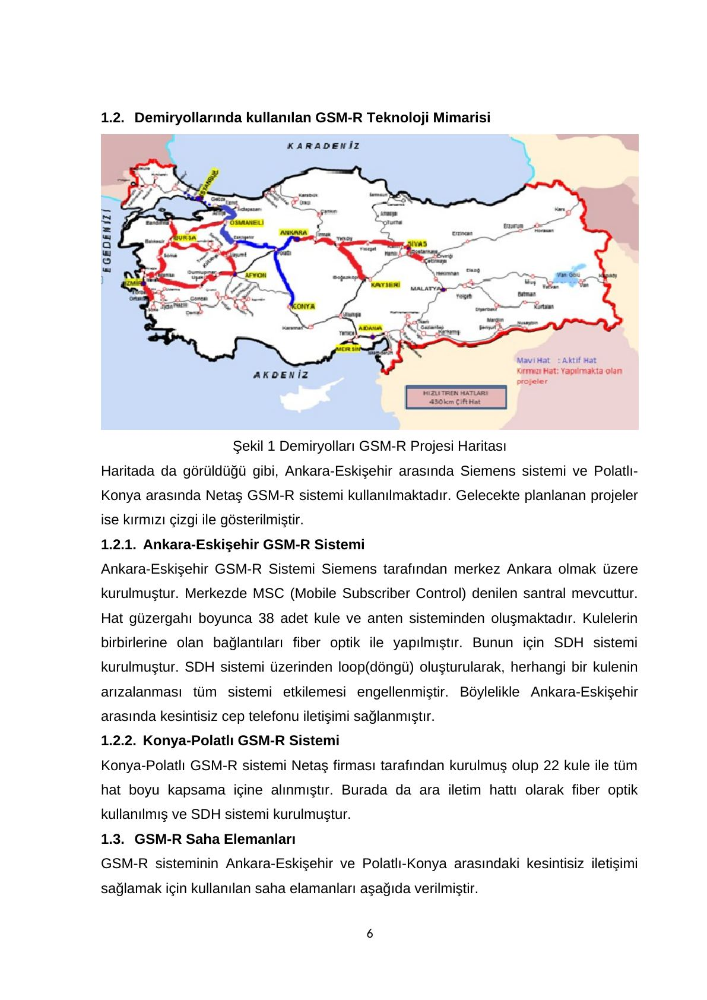

This post is the **first part** of a 70-page report dated 2014, prepared by a friend for a summer internship at the TCDD High-Speed Train (YHT) Regional Directorate, Facilities Directorate in Ankara. It covers the history and organization of the railways, followed by telecommunications (the GSM-R system, digital transmission, SDH/DWDM and fiber optics). The report's [signalling section](/arsiv/staj-tcdd-yht-sinyalizasyon-ertms-ray-devreleri-makaslar/) and [electrification section](/arsiv/staj-tcdd-yht-elektrifikasyon-katener-sistemi/) are in separate posts. Personal information has been removed; the original pages (36 pages) can be downloaded as a PDF at the end of the post.

## Turkish State Railways (TCDD)

First, I was introduced to the engineers, technicians and other staff at the YHT Facilities Directorate and learned briefly about their duties. Then I received brief information about the units where I could do my internship. The YHT Facilities Directorate consists of the GSM-R Exchange and Communications Chief's Office, the Signalling and Telecommunications Chief's Office, and the Electrification Chief's Office, which make up what is called the superstructure of railway operations.

### History of the Railways

The railway history of our country is examined under three headings: the pre-Republic period, the Republic period (1923-1950), and the post-1950 period. The distinguishing features of these periods are, first, that most of the railway lines were built under concessions granted to foreigners; second, that it was the golden age of railway transportation; and third, that railway transportation was neglected.

### Pre-Republic Period

Turkish railway history begins in 1856. The first railway line, the 130 km İzmir-Aydın line, was completed between 1856 and 1966. Between 1856 and 1922 the following lines were built on Ottoman territory:

- Rumelia Railways: 2383 km of standard-gauge line
- Anatolia-Baghdad Railways: 2424 km of standard-gauge line
- İzmir-Kasaba and its extension: 695 km of standard-gauge line
- İzmir-Aydın and its branches: 610 km of standard-gauge line
- Damascus-Hama and its extension: 498 km of narrow- and standard-gauge line
- Jaffa-Jerusalem: 86 km of standard-gauge line
- Bursa-Mudanya: 42 km of narrow-gauge line
- Ankara-Yahşihan: 80 km of narrow-gauge line

### Republic Period (1923-1950)

Of the 8619 km of railways built during the pre-Republic period as a result of concessions granted to foreign companies, about 4000 km remained within the national borders drawn with the proclamation of the Republic. Thus the railways, which had been built under concessions granted to foreign companies, under their control, and serving foreign economies and political interests, were restructured after the Republic in line with national interests; the aim was to create a self-sufficient "national economy" and to have the railways mobilize the country's resources. A distinguishing feature of this period is that the 1st and 2nd five-year industrialization plans, prepared in 1932 and 1936, gave priority to basic industries such as iron and steel, coal and machinery. Railway investments were emphasized because they allowed such bulk loads to be carried most cheaply. For this reason, the railway lines were directed toward national resources and were a guiding factor in determining site selection as industry spread across the whole country. Railway construction continued at great speed until the Second World War, but slowed down after 1940 because of the war. Of the 3578 km of railway built between 1923 and 1950, 3208 km were completed by 1940. The road system, for its part, was designed in this period to feed the railway. Kayseri was connected to the railway network in 1927, Sivas in 1930, Malatya in 1931, Niğde in 1933, Elazığ in 1934, Diyarbakır in 1935 and Erzurum in 1939.

### Post-1950 Period

At a time when highways should have been developed to complement and support the railways, road construction began with Marshall aid while the railways were virtually ignored. In this period, when the USA was influential over the Turkish economy through Marshall aid, an industrialization process based particularly on agricultural and consumer goods dominated the economic structure. As a result of this policy, only 30 km of new line could be built between 1950 and 1980. Between 1950 and 1997 the length of highways increased by 80% while the length of railways increased by 11%. Because the existing infrastructure and operating conditions of the railways could not be improved and new corridors could not be opened, their share in passenger transport has declined by 38% over the last 50 years. On the other hand, about 14 million tons of freight were transported in 2002.

Today the railways are trying to regain their former vitality. The most obvious examples of this are the large investments made in high-speed trains. Our country has been introduced to high-speed train services between Ankara-Eskişehir and Ankara-Konya and has reached the European average. Ankara-Istanbul high-speed train services will begin in the near future.

### Railway Organization in Turkey

The supervision, oversight, coordination and relations of TCDD at the government level are arranged by the Ministry of Transport. The Central Administration consists of 18 Specialized Departments together with the Legal, Defense and Press and Public Relations units, and services related to railway transportation are carried out by 8 Regional Directorates. The TCDD network is divided into 8 regions in total, and each region is administered by a separate Regional Directorate. These regional directorates are, respectively, as follows.

- 1st Regional Directorate – Haydarpaşa

- 2nd Regional Directorate – Ankara

- 3rd Regional Directorate – İzmir

- 4th Regional Directorate – Sivas

- 5th Regional Directorate – Malatya

- 6th Regional Directorate – Adana

- 7th Regional Directorate – Afyon

- 8th YHT Regional Directorate – Ankara

## A. Telecommunications

## 1. GSM-R System

GSM-R (Global System for Mobile-Railway) is a system that provides communication and data transmission between the control center and the YHT train sets along the YHT line. At the center, communication takes place over the air interface between the dispatcher, who monitors train movements, and the train driver. The system aims to maintain communication between the center and trains traveling at 250 km/h. In this system, in which handovers from one cell to another are faster than in normal GSM systems, communication can be maintained without interruption even at speeds of about 500 km/h. Aware that communication is very important in railway transportation, TCDD provides its own communication by building a closed network with the GSM-R system. GSM-R is a technology of proven success and is currently deployed in more than 15 countries worldwide.

In the early 1980s there were many railway communication systems operating across Europe, which slowed cross-border traffic and increased its cost. With increasing economic integration within the European Union, applying GSM systems to the railways was considered in order to adopt a single standard for train radio communication. For this reason GSM-R is a technology designed "for the railways, by the railways". It enables uninterrupted communication at a train speed of 250 km/h and also supports speeds of 500 km/h. According to 2011 data, the GSM-R system is used on 150,650 km of the 221,025 km of European railways.

### 1.1. Why GSM-R?

- Interoperability: It provides railway communication without system boundaries.
- It increases the travel speed of trains thanks to uninterrupted communication.
- By offering uninterrupted passenger transport service, it shortens travel time and increases comfort and convenience.
- It increases track (line) capacity through minimized headways between trains.

### 1.1.1. Services Provided by the GSM-R System

- Train Control o Signalling o ETCS Level 2,3 o Movement Authorities o Warning and Caution Notification o Ensuring System and Data Operation Safety
- Radio Monitoring o Fleet Management o Crew Management o Vehicle and Material Tracking o Status Reporting o Accident Alarm Notification
- Passenger Services o Seat Reservation o Ticket Purchase o Passenger Information
- Maintenance Data o Train Maintenance Status o Fault Notification o Rail Defect Detection o Boarding/Alighting Passenger Counting
- Written Notification o Operation-related/unrelated Written Notification
- Security Surveillance o CCTV Camera System o Surveillance with Local and Remote Access o Monitoring and Tracking System o Alarm Notification
- Travel Information o Distance and Time Notifications o Transport Condition Measurement (Temperature Measurement, etc.) o Estimated Arrival Time o Cargo Tracking

### 1.2. GSM-R Technology Architecture Used in the Railways

*Figure 1 Railways GSM-R Project Map*

As can be seen on the map, the Siemens system is used between Ankara-Eskişehir and the Netaş GSM-R system is used between Polatlı-Konya. Projects planned for the future are shown with a red line.

### 1.2.1. Ankara-Eskişehir GSM-R System

The Ankara-Eskişehir GSM-R System was installed by Siemens, with its center in Ankara. At the center there is an exchange called the MSC (Mobile Subscriber Control). Along the line route it consists of 38 tower and antenna systems. The towers are connected to each other by fiber optic. An SDH system was installed for this purpose. By creating a loop over the SDH system, the failure of any single tower is prevented from affecting the whole system. In this way uninterrupted mobile phone communication has been provided between Ankara and Eskişehir.

### 1.2.2. Konya-Polatlı GSM-R System

The Konya-Polatlı GSM-R system was installed by the company Netaş, and the whole line is covered by 22 towers. Here too, fiber optic is used as the intermediate transmission line and an SDH system has been installed.

### 1.3. GSM-R Field Elements

The field elements used by the GSM-R system to provide uninterrupted communication between Ankara-Eskişehir and Polatlı-Konya are given below.

### 1.3.1. BTS (Base Transceiver Station)

In the GSM-R system used in railway communication, communication is carried over 2 Mb channels. That is, the BTSs in the field are connected to each other with 2 Mbit channels. This is called PCM30. The BTS converts the signal it receives from the antenna into 2 Mbit voice channels. Alarms are also sent to the center over the 2 Mbit link.

*Photo 1 BTS Plus*

### BTS Voice Channels

")

A 2 Mbit voice channel contains a total of 32 channels, numbered 0-31. Each of these channels consists of a TDMA (Time Division Multiple Access) frame of 125 µs. Of these channels, channels 0, 16 and 31 are used for signalling communication.

*Figure 2 BTS Voice Channels*

In the railways GSM-R network, the frequencies are 876-880 MHz for the uplink and 921-925 MHz for the downlink. Each of these frequency bands is divided into 200 KHz frequency channels.

*Figure 3 GSM Frequency Bands*

### 1.3.1.1. Technical Buildings

")

For the trackside systems of the railways, technical buildings have been built approximately every 10 km. These technical buildings house power panels and signalling systems, including the GSM-R systems.

### 1.3.1.2. Towers

The towers used in the railways GSM-R system are either 30 m or 50 m, depending on the location. In GSM technology, 900 MHz (Turkcell, Vodafone), 1800 MHz (Avea) and 1900 MHz (only in America) are used. GSM-R technology also operates at about 900 MHz. In theory, in systems operating at 900 MHz it is possible to provide communication within a maximum radius of 35 km. In systems operating at 1800 MHz and 1900 MHz this radius drops to 8 km. In railway GSM-R a 35 km radius is possible, but this distance decreases considering that the terrain includes mountainous sections. Therefore, in GSM-R technology the distance between towers is about 10 km in order to provide uninterrupted coverage along the line. Depending on the terrain, masts of 30 or 50 m height were used. Aircraft warning lights are used at the top of the masts.

The towers are made of galvanized steel and have also been subjected to tensile and fracture tests. In GSM technology there are 3-legged towers as well as 4-legged ones, and the 4-legged ones are the most preferred. All towers on the railways are 4-legged towers. For the erection of the towers, the base legs are seated on a 3 m x 3 m x 3 m concrete foundation.

*Photo 2 GSM-R Tower*

### 1.3.1.3. Antennas

")

")

Since the aim in railway GSM-R technology is coverage along the line, an antenna connection with two sectors on each tower has generally been implemented. The frequency range of the antennas is 806-960 MHz, 15 dBi. Each antenna is directed toward the line with an angle of 120°.

*Figure 4 GSM-R Antenna and Coverage Angles*

### 1.3.2. BSC (Base Station Control)

The Base Station Control is located at the center and collects all the BTSs in the field under itself. Up to 128 BTSs can be connected to one BSC. It sends all incoming 2 Mbit voice channels to the transcoder called the TRAU. All field elements can be reached through the BSC, and many operations can be performed by remote access. In other words, the BSC acts as the brain of the system.

On the BSC there is a card called COBA, which holds the entire database. This card is redundant, as module 0 and module 1. When one of the cards fails, the other card takes over the entire load and continues to operate without interruption.

On the BSC there is a card called PEXE, which collects the environmental alarms and plays a role in displaying them on the screen. Thus, when a fault occurs on the network, the alarm is displayed through this card.

### 1.4. Transcoding Unit (TRAU)

This module, called the TRAU (Transcoding and Adaptation Unit), is responsible for encoding and compressing the 2 Mbit voice channels between the BSC and the MSC. The TRAU is also the element responsible for rate adaptation between the BSC and the MSC. The TRAU compresses 4 2 Mbit voice channels onto one PCM30 and forwards it to the LTG on the MSC. This interconnection is made with fiber optic cable. The fiber optic cable leaving the TRAU enters the LTG (Line Trunk Group) through a connection device called the FOT-X. The FOT-X converts the light signal coming from the fiber optic into an electrical signal and passes it to the relevant card.

*Photo 3 GSM-R TRAU*

*Figure 5 Simple Representation of the GSM-R Structure*

### 1.5. Power Supplies

")

In the technical buildings, the GSM-R systems are powered from the catenary system used by the railways and from the mains. On the catenary and mains power panel there is a rack called the OTP, which contains two isolation transformers.

The catenary is single-phase and supplies 230 V AC to the OTP. For the catenary voltage, a catenary filter and a stabilizer are placed after the isolation transformer. Their purpose is to prevent the systems from being damaged, since the catenary voltage varies. The stabilizer balances any excess voltage that may come from the catenary. This is because the railway catenary is 27500 V. Therefore a catenary transformer must be used for the 27500 V – 230 V conversion.

The mains voltage is supplied by TEDAŞ and is a constant 220-230 V. For this reason no stabilizer or filter is needed for the mains.

The OTP rack also contains a time relay. It engages within 8 s after power is applied and protects the system against overcurrents.

The primary supply of the GSM-R systems inside the technical building is from the catenary. If the catenary is cut, power is taken from the mains by means of contactors K1 and K2, and the system is prevented from going down.

*Figure 6 Electrical Structure of the OTP Panel*

The system operates at -48 V DC. The AC voltage coming from the OTP panel goes to the rectifier. The rectifier is a system that feeds the batteries, so its output is DC. To supply the system there are 4 12 V lead-acid dry batteries of 60 Ah each. The system draws about 20 A.

### 1.6. Access to Field Elements

### 1.6.1. LMT (Local Maintenance Terminal)

")

The Local Maintenance Terminal is a management terminal that can be connected through a serial port (25DB) on the BTS or BSC. In short, it is the user interface. The connection speed is 4.8 Kbit/s. With this program we can see the faults on the system and make the necessary software-related changes on the system. This program is used to bring up newly installed BTS or BSC systems.

*Figure 7 Login Page of the LMT Program*

The login screen of the LMT program is as above. We connected to the system through the BSC. After entering the username and password, a view of the system appears on the screen. There are two views here: graphic or tree mode.

Some screenshots are as follows.

*Figure 8 LMT Program Screenshots*

### 1.6.2. RC (Radio Commander)

")

The RC is a powerful system with a large server behind it, running the LINUX operating system. With the Radio Commander an entire network can be seen on a single screen at the same time. It can detect faulty systems instantly and can even give audible warnings. All sites can be controlled at the same time. The BSC and BTS systems can be intervened on with the RC. Reports can be generated. It is more powerful than the LMT program, but the LMT is used during commissioning.

*Figure 9 RC Main Page Screenshot*

*Figure 10 GSM-R RC Screenshot*

### 1.7. In-Train GSM-R System

### 1.7.1. Cab Radio

")

So that the driver can establish a connection with the center inside the train cab, CAB_RADIO installations have been made. Each train has two cab radios, one at the front and one at the rear. The cab radio consists of an MMI (display), a handset, a loudspeaker, an antenna and the radio unit. A shark-fin-shaped antenna is mounted on the train set. It provides uninterrupted communication of the trains with the center between Ankara-Eskişehir and Konya-Polatlı.

There are 12 train sets in total, with 24 cab radios. Emergency calls, group calls or normal GSM-R calls can be made through the MMI. The cab radio is mounted in a cabinet inside the set. All connections are checked from the radio through a box called the GLEND-BOX.

*Figure 11 In-Train GSM-R Equipment*

*Figure 12 Cab Radio Connection Diagram*

### 1.8. Alarms

Alarms coming from the field elements can be seen easily on the RC. When a fault occurs at any site, it appears on the screen. The alarm types are listed below.

### 1.8.1. Alarm Types

") a. Communication Alarm A communication alarm relates, in principle, to the procedures and/or operations needed to transfer information from one point to another.

b. Quality of Service Alarm A quality of service alarm relates, in principle, to a degradation in the quality of a service.

c. Processing Error Alarm A processing error alarm relates, in principle, to a software or processing error. d. Equipment Alarm An equipment alarm relates, in principle, to a hardware fault.

e. Environmental Alarm An environmental alarm relates, in principle, to a condition in the enclosed environment in which the equipment is located.

Alarms are also classified by severity as critical, major and minor. Alarms are cleared automatically or manually when the fault ends.

*Figure 13 Alarm Screenshots on the RC*

### 1.9. Power Failure

The fault concerned the collapse of the BTS system in the technical building at railway Km 518+000. Looking at the alarm monitor on the RC, it appeared that there was no power on the BTS. According to the initial findings, the fault was thought to be either a power problem or on the link connected to the center. Looking at the BTSs neighboring this technical building, Km 510+000 was reporting a link error. The neighbor on the other side, Km 523+000, was reporting a complete error on the screen. In this situation it was decided to go to the technical building and investigate on site.

When we arrived at the technical building, we saw that there was no power on the OTP panel. 220 V mains supply was reaching the system, but the OTP rectifier was not being fed. The catenary power had been deliberately switched off, because the OTP catenary stabilizer was faulty and the system was drawing high current. It was then decided that the K2 contactor was faulty. Power was cut from the main supply, the contactor was replaced, and the system returned to normal.

### 1.9.1. K Contactor

The K contactor is a contactor that pulls in when power arrives. Two contactors are connected side by side on the OTP panel. Whichever contactor has power pulls in and feeds the system. The L2 and T2 terminals on the contactor are the contactor supply. These are connected to a time relay. When power arrives at the system, the relay energizes the contactor after 8 seconds, causing the contactor to pull in.

*Figure 14 K Contactor*

There is a core inside the contactor. If excess current or voltage reaches the contactor, the core heats up and the plastic part covering the core melts. This prevents the contactor's contacts from sticking to each other. The contactor thus becomes faulty. To restore the contactor, the core must be replaced.

### 1.10. Center

The central exchange has a very complex structure. The connection between the central MSC and the BSC is made through the TRAU. The 2 Mbit channels leaving the TRAU arrive by fiber optic at a rack group called the LTG (Line Trunk Group). From there they go to the SSNC (Sub-switching Network Center). After switching is performed here, the connection is established at the CP (Control Processor). If a data connection is to be made over GPRS (General Packet Radio Service), the connection is made from a slot on the BSC called the Gb interface to the SCSN rack. If an SMS (Short Message Service) is sent, the connection is made on the LTG to the SMSC rack. In fact the most important unit at the center is the SSNC, because it is where all network switching is performed. The system also allows short-code dialing. For example, with the short code 1200 we can call the Dispatcher center. In fact, behind the dispatcher center number 1200 there is an 11-digit number. It is also possible to send messages through this short code. To carry out this call, there is a unit called the Intelligent Network (IN). In a short-code call, before establishing a connection with the CP, the SSNC asks whether the short code is defined on the IN; if it is defined, the IN sends the 11-digit number behind the short code to the SSNC. After that, the SSNC establishes the connection with the CP. For the connection to take place, you must be registered on the network. Within the CP there are units called the HLR (Home Location Register) and VLR (Visitor Location Register). The HLR records the 18-digit number on the SIM card, starting with 28611xxxxxx. During a call, whether this number exists in the HLR is checked at the verification center called the AC (Authentication Center). If it exists, the connection is established. The VLR handles the connections of SIM cards that belong to other MSCs. However, since there is only one MSC on the railways, there are no connections with other MSCs (AVEA, TURKCELL, VODAFONE).

For PBX connections to be possible in the system, there is a HI-PATH mini exchange compatible with the system. Through this exchange the railways' internal network connections can be made.

The central system can also place calls to emergency numbers such as 110, 112, 155 and 156. These calls can be made from any desired point along the railway line.

There is also a server called NICE, on which all conversations related to train traffic are recorded. The connections between the dispatcher and the drivers are recorded here. With these Windows 2003 server-based PCs, the recordings are kept for at least 6 months.

### 1.10.1. Central Control Room

")

There is a control room at the center in order to control the whole system. There are a total of 9 computers here, including redundant ones. These are the Radio Commander, IN, NICE, Switch Commander (2 units), GPRS Commander (2 units), TNMS (for the SDH system) and SPOTS (for call traffic).

### 1.10.2. SC (Switch Commander)

The most important computer in the central control room is the SC system, through which many authorizations can be granted on the MSC exchange. This computer works with the MML command system and is connected directly to the CP. It can control the LTG, CP and SSNC.

*Photo 4 Central Control Room Photos*

## 2. Communication Systems

### 2.1. Digital Transmission

Digital transmission is the transmission of digital pulses between two points in a communication system. The original source information may be in digital or analog form. If the source information is analog, it is converted into digital pulses before transmission and back into analog form at the receiver. The most important advantages and disadvantages of digital transmission compared with analog transmission are as follows.

### 2.1.1. Advantages of Digital Transmission

1- Its immunity to noise is its most important advantage. Analog signals are more susceptible to undesirable amplitude, frequency and phase variations than digital pulses. The reason is that in digital transmission these parameters do not need to be evaluated as precisely and exactly as in analog transmission.

2- Digital pulses are better suited than analog signals for processing and multiplexing. Digital pulses can easily be stored, whereas analog signals are not easy to store. In addition, the transmission rate of a digital system can easily be changed so that it can adapt to different environments and be connected through an interface to different kinds of equipment.

3- Errors can be corrected. 4- It can be easily implemented with integrated circuit technology.

### 2.1.2. Disadvantages of Digital Transmission

1- Transmitting analog signals as digitally coded signals requires more bandwidth than transmitting the analog signals as they are.

2- Analog signals must be converted into digital codes before transmission and back into analog form at the receiver.

3- Digital transmission requires synchronization between the clock pulses of the transmitter and the receiver.

4- Digital transmission systems are not compatible with the analog system equipment currently in use.

### 2.2. Digital Transmission Systems (PCM Systems)

Pulse code modulation (PCM) is the coding of samples taken from an analog message signal. The principle of pulse code modulation is to obtain a time-domain sample of the analog signal, encode that sample in digital form, and transmit the encoded digital values as a digital bit stream. At the receiver, the reverse of this process is performed. The signal is regenerated, decoded and integrated to obtain the analog signal. In this way, the signal is transmitted as a digital signal in the form of a simple on/off (0,1) sequence, so that it is not affected by the noise and distortion of the transmission medium and can easily be regenerated in regenerators (repeaters).

*Figure 15 Simple Representation of PCM Channels in One Direction*

The conversion of an analog signal into a digital signal is carried out in three stages: sampling, quantization and coding.

*Figure 16 Stages of Converting an Analog Signal into a Digital Signal*

### 2.3. Plesiochronous Digital Hierarchy (PDH) System

")

With the development of semiconductor technology, PCM technology became economically viable and widespread in the 1960s. In the early days of transmission, first-level PCM systems with 24 and 30 channels were used. Because of growing communication demands, new higher-level bit rates multiplexing 120 and 480 channels were later defined. The standardization scheme describing these transmission systems was called the plesiochronous digital hierarchy.

In PDH, when multiplexing first-level signals into higher-level signals, the simple byte-interleaving technique could not be used, because under the conditions of the time it was not possible to synchronize all systems from a single center. As a result, signals were multiplexed to higher levels by bit-interleaving: taking one bit from each signal in turn and arranging them one after another. Thus the bits making up the 64 kbit/s signal are distributed throughout the entire transmission frame. Because the signals at the various levels in PDH are not synchronous, bit stuffing is required, and therefore every higher-level frame in PDH contains a certain number of stuffing bits.

Because of bit stuffing, it is difficult to locate the bits. The number of stuffing bits used in higher-level PDH frames cannot be known unless demultiplexing is performed. This is why it is not possible to directly extract a 2 Mbit/s signal or a 64 Kbit/s data channel from within a 140 Mbit/s signal. For the same reason, we cannot directly insert a Mbit/s signal or a single-channel signal into a higher-level signal.

In PDH systems, to reach a channel or one of the lower levels, or to add to one, demultiplexing down to the desired level is required.

*Figure 17 Conversion/Add-Drop Operation in a PDH System*

Table 1: PDH levels

| Level (order) | North America / Japan standard: capacity | Number of channels | European standard: capacity | Number of channels |
| --- | --- | --- | --- | --- |
| 0 | 64 Kbit/s | 1 | 64 Kbit/s | 1 |
| 1 | 1.544 Mbit/s | 24 | 2.048 Mbit/s | 30 |
| 2 | 6.312 Mbit/s | 96 | 8.448 Mbit/s | 120 |
| 3 | 44.736 Mbit/s | 672 | 34.368 Mbit/s | 480 |
| 4 | 139.264 Mbit/s | 1920 | 139.264 Mbit/s | 1920 |

Existing PDH systems go up to a maximum rate of 140 Mbit/s. A digital signal at this bit rate can carry 1920 telephone channels simultaneously. Although the 565 Mbit/s bit rate is not standard, it is used in long-distance networks to carry 7680 channels.

### 2.4. SDH SYSTEM

As explained in the section on PCM systems, two different standards emerged. European countries chose a bit rate of 2048 Kbit/s, while countries such as the USA, Canada and Japan used the American standard with a basic bit rate of 1544 Kbit/s. The use of two different standards in PCM systems created problems in international connections. When crossing national borders, signals had to be converted to the standard used in the country being crossed so that they could be carried within it, which significantly increased the cost.

A new synchronous system was needed in order to create a worldwide standard, to enable new services and communication techniques, and to make network management more efficient and economical. Research began in the USA in the mid-1980s, and the SONET standard for North America was developed at the Bellcore laboratory.

CCITT accepted this standard in terms of content and, in order to unify all systems in the world into a single standard, developed the Synchronous Digital Hierarchy (SDH) by defining the bit rates, signal structure and basic multiplexer structure for SDH; the SDH standard was established in 1988 by agreement of the countries making up CCITT.

In an SDH transmission network, the network is synchronized to a single master clock. This made it possible to use in SDH systems the byte-interleaved multiplexing technique, which could not be used in PDH.

In SDH, lower-level signals are multiplexed into higher-level signals by interleaving bytes (byte-interleaved multiplexing). Although byte-interleaved multiplexing requires a complex structure, this type of multiplexing has an important advantage. Since one byte (8 bits) corresponds to a 64 Kbit/s (8 bits x 8 kHz) voice channel signal, this structure is preserved intact within the multiplexed signal.

As will be recalled, in the PDH hierarchy, signals are multiplexed to higher orders by placing bits one after another, and the signal structure is destroyed. For this reason, in PDH systems reaching the desired signal level or data channel requires demultiplexing from the current level all the way down to the lowest level, whereas in SDH it is possible to reach the desired signal level or channel directly. Thus a lower-level signal can be added to or dropped from a higher-level signal directly, without traversing the demux/mux chain.

### 2.4.1. Frame Structure of the SDH System

")

The SDH transmission frame is called a Synchronous Transport Module (STM) and is written as STM-N to indicate the SDH level.

The basic signal in the SDH hierarchy is STM-1, with a data rate of 155.520 Mbit/s. The STM-1 signal is a low rate provided for line communication in SDH.

*Figure 18 STM-1 Frame Structure*

### 2.4.2. Characteristics of the STM-1 Frame

")

9 x 270 = 2,430 bytes with a 125 µs period: 2,430 x 8 x 8 = 155.520 Mbit/s bit rate.

The transmission capacity of a single byte of the frame is 64 Kbit/s. Transmission of the frame is carried out row by row, starting from the top left corner. The frame structures of the higher-level signals in SDH are multiples of the basic STM-1 frame. All STM frames have a period of 125 µs. STM-1 can carry a single 140 Mbit/s signal or a certain number of PDH signals at lower rates. In general, in an STM-N frame;

- Overhead: 9 rows x 9 bytes x N
- Payload: 8 rows x 261 bytes x N As a result, the bit rate is N times the bit rate of the STM-1 frame. PDH signals of various hierarchical levels can enter the input of SDH multiplexers. Synchronous multiplexers place PDH signals in a planned manner into fixed-length virtual containers (VC). In this way, the general characteristics and physical layers of PDH are left behind. Standardized SDH bit rates;

Table 2: SDH bit rates

| Level | Bit rate (Mbit/s) | Number of channels |
| --- | --- | --- |
| STM-1 | 155.520 | 1890 |
| STM-4 | 622.080 | 7560 |
| STM-16 | 2,488.320 | 30240 |
| STM-64 | 9,953.280 | 120960 |

*Note: In the report's table the last row also reads "STM-16"; the 9,953.28 Mbit/s rate belongs to STM-64 (Figure 19 also shows STM-64), so it has been corrected here.*

*Figure 19 SDH Levels*

### 2.4.3. Differences Between PDH and SDH

| PDH | SDH |
| --- | --- |
| Plesiochronous digital hierarchy | Synchronous digital hierarchy |
| Plesiochronous network (internally free-running oscillator) | Synchronous network (oscillator driven by an external clock) |
| Asynchronous multiplexing technique | Synchronous multiplexing technique |
| A special transmission frame is defined for each multiplexing level. | All multiplexed signals have an identical frame structure. |
| Bit-by-bit multiplexing | Byte-by-byte multiplexing |
| Bit-by-bit positive justification timing sequence | Bit-by-bit positive/zero/negative justification timing sequence |
| Bit rates up to 140 Mbit/s are standardized | Bit rates above 155 Mbit/s are standardized |

### 2.4.4. Comparison of PDH and SDH Systems

When PDH and SDH systems are compared, the following advantages and disadvantages of SDH emerge.

### 2.4.5. Advantages of SDH

1. Bit rates above 140 Mbit/s have been standardized internationally for the first time.
1. The code for transmitting the optical signal over the line has been standardized. It is therefore compatible with the line equipment of different manufacturers. Thus manufacturers can produce systems more cheaply for a single worldwide market.
1. Modular structure: multiplexed bit rates are produced as integer multiples of the basic bit rate. The frame structure of the multiplexed signals is identical to that of the basic signal. This means that no new frame needs to be defined.
1. Access to a single channel in the multiplexed signal is possible by evaluating the pointer data. Since only the desired channels need to be separated out, this method is an advantage for branching with cross-connect systems.
1. Network resources are synchronized to a single master clock.
1. It provides powerful network management capability. This means flexibility and high reliability.
1. Protection and backup against main-line and network element failures are possible.
1. Transmission of the broadband signals envisaged for the future is possible.
1. Conversion of an electrical signal into an optical signal is possible without complex line coding. Error monitoring is carried out through full parity supervision in the various transmission sections.

### 2.4.6. Disadvantages of SDH

It is a complex and meticulous technique, because the relationship between the tributary signal and the line in the header has to be recorded.

Because of SDH's American origin, some inadequacies remain in the transmission of CEPT hierarchy signals. For example, although its capacity would allow a 4x34 Mbit/s signal to be carried, only 3x34 Mbit/s of data can be transmitted in STM-1.

### 2.4.7. Operating Principle of SDH

We can explain the transfer of information from one point to another in SDH by analogy with freight transport. Let us imagine that SDH transmission is carried out with information packages of various sizes carried by trucks travelling through the network at approximately the speed of light. The size of the trucks indicates that the SDH element operates at a main line rate such as 155 Mbit/s, 622 Mbit/s or 10 Gbit/s. Service signals can be voice, data and video. The service signals are specially packaged by the SDH element that will send them and loaded onto the trucks. When the truck reaches another SDH element, only this package is reached and unloaded. If there is another package to be put in, it is placed in the vacated spot. The places where each SDH element will pick up its load from the truck and load onto it are determined in advance, and this way of transferring information over the network is called add/drop. SDH elements know the position within the truck of the virtual containers belonging to them and obtain their information by reaching these packages directly.

*Figure 20 SDH Network Structures*

### 2.5. WDM Multiplexing

")

- It is the process of transmitting the information of more than one channel over a single transmission medium, each at a different wavelength, within a certain hierarchy.
- DWDM system: Optical transmission systems that operate on the wavelength-division multiplexing technique and are used for very high-capacity transmission needs between cities.
- It consists of 3 different elements: Terminal, ADM and Repeater.

*Figure 21 View of Traffic Channels in an SDH System*

### 2.5.1. Advantages of DWDM Technology

- The ability to carry a large number of high-speed channels over a single fiber pair
- Capacity increases can be met easily and quickly by adding cards to existing links.
- System reliability provided by optical switching and routing technology.
- Access to all network elements from a single point, since advanced operation/management functions can work integrated with SDH systems.
- Ease of investment and operation and economic savings through powerful operation/management systems together with the use of fewer fibers and less equipment
- DWDM systems exist that can carry 8, 16, 32, 64, 80 and 160 channels over one pair of fibers
- Each channel can carry information at rates between 100 Mb/s and 10 Gb/s.

### 2.6. Railways SDH Network

In the State Railways (TCDD), there are a total of 4 SDH networks: two between Ankara and Eskişehir, and one each between Ankara-Konya and Ankara-Behiçbey. In addition to these, there is one network that also includes WDM technology.

1. Between Ankara and Eskişehir there is the SDH system installed during the initial construction of the high-speed train line. Over this system, the data of train traffic and the GSM-R system can be transmitted. The system has an STM-16 structure and is backed up over a different strand within the fiber. It also has a topology like the infinity symbol, so the system is not affected by any SDH failure in the network.

2. Between Ankara and Eskişehir, a new SDH system was installed during the development of the GSM-R system. Only GSM-R communication is carried over this system.

3. Between Ankara and Konya, an SDH system was installed that is backed up with fiber laid on both sides of the railway line. Thus the system is backed up over a different fiber optic cable, providing uninterrupted communication. GSM-R and traffic data are carried over this SDH system.

1. The SDH system installed between Ankara and Behiçbey using STM-4 is one of the oldest systems and is responsible for telephone and internet transmission between Ankara and Behiçbey.

5. The newly installed WDM technology was installed on a separate fiber between Ankara, Eskişehir and Konya. The data of the camera systems are carried over this system.

In conclusion, the Railways use advanced systems in the SDH system. By extending the SDH network to the new high-speed train lines to be built, it will have an even larger network.

## 3. Fiber Optic System

### 3.1. Fiber Optic System

Fiber optics is a system that works on the principle of transmitting light through a precisely manufactured pure glass thread about as thick as a human hair. The main reasons for preferring cables made this way are that they are unaffected by places where environmental conditions are very harsh, such as damp, humid places and places with heavy electric-field interference, and that they always provide a stable connection. Fiber optic cables carry out transmission at the speed of light, 300 thousand km per second. For these reasons they are designed for data transfer over long distances.

Electronic communication is fundamentally carried out by the displacement of electrons. Therefore factors such as the type, structure and dimensions of the conductor used affect the communication speed. As a result of research, after sound and electricity, light also began to be used for communication. Optical fiber was developed for information transfer with light. Systems that carry information by means of optical fiber are called fiber optic systems.

### 3.1.1. Advantages of Fiber Optic Cable

- Wide bandwidth
- Low loss
- Electromagnetic immunity
- Reliability
- Light weight
- Small size
- Resistance to radioactive radiation
- Information security (no leakage)
- No grounding problem
- Flexibility

### 3.1.2. Disadvantages of Fiber Optic Cable

- Splicing end to end is not easy.
- Splicing requires extra maintenance care.
- It is somewhat expensive economically.

### 3.1.3. Parts of Fiber Optic

")

Core (φ: 9 / 50 / 62.5 microns) Cladding

1. Coating (φ: 200 microns)

1. Coating (φ: 250 microns)

*Figure 22 Fiber Optic Cable and Its Structure*

Center (Core): The thin glass layer in which light travels.

Cladding: The part, made of optical material, that surrounds the core and sends light reflected from the core back into the core.

Coating: The outer layer that protects the cable against impacts and moisture.

### 3.2. How Do Fiber Optic Cables Transmit Light?

The beam sent from the laser initially follows a straight path. At the points where the cable bends, the light signal strikes the glass cladding and is reflected back, as seen in the figure. In this way the light signal continues along its path in the core.

*Figure 23 Movement of Light in a Fiber Optic Cable*

### 3.3. Types of Fiber Optic Cable

### 3.3.1. Single-Mode Fiber:

It is used to carry information over long distances. This distance is generally 80 km. A repeater or SDH is required for greater distances.

### 3.3.2. Multimode Fiber:

It is used mostly to carry information over short distances. However, with these fibers more light signals can be sent at the same time. The maximum distance is 2 km.

I learned about the patch cables, patch panels and fiber optic connectors used in fiber optic cabling.

### 3.4. Fiber Optic Cable Elements

### 3.4.1. Fiber Patch Cables

")

Fiber optic patch cables are generally located where the systems are and provide the connection between the terminated main fiber cable and the system. They can be single-mode or multimode fiber. Single-mode fibers are generally designed in yellow, and multimode fibers in orange.

*Figure 24 Patch Cables Used in Fiber Optic Cabling*

### 3.4.2. Fiber Patch Panel

Patch panels are the places where the fiber optic cable is terminated. Its other name is ODF (Optical Distribution Frame). These panels are designed for fiber optic cable and provide easier installation and maintenance. Each strand of the fiber optic cable is terminated inside the patch panel. If access to the system is needed, the connection is made from this point with a patch cable.

*Photo 4 Photo of a Fiber Optic Patch Panel*

### 3.4.3. Fiber Optic Connectors

")

*Figure 25 F/O Connectors*

### 3.5. Fujikura OTDR Device

")

The Fujikura OTDR device used in the Railways is used for measuring fiber optic cable.

*Photo 5 Fujikura OTDR Device*

Applications that can be performed with this device;

- Fault finding
- Power level tests
- Optical spectrum analysis tests
- Attenuation profile tests
- Chromatic dispersion tests
- Signal loss and optical return loss tests The device is very flexible because it is small and portable. It is also easy to use.

### 3.5.1. Fiber Optic Measurement

")

A fiber optic measurement made with the Fujikura OTDR device is shown in the figure below. OTDR SCREEN DISPLAY Connector Connections Splice Points Test Cable Initial signal Connector Connection Reflections Power (dB) The image displayed on the screen in the measurement we made is similar.

Cable Splice Losses Connector Connection PHOTO TO BE ADDED HERE Losses Fiber Optic Losses Distance (km)

*Figure 26 OTDR Screen Display*
