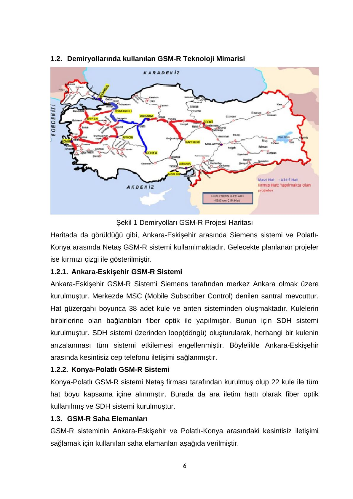

Bu yazı, Ankara'da TCDD Yüksek Hızlı Tren (YHT) Bölge Müdürlüğü Tesisler Müdürlüğü'nde yapılan yaz stajı için bir arkadaşın hazırladığı 2014 tarihli, 70 sayfalık raporunun **ilk bölümüdür**: demiryolu tarihçesi ve örgütlenmesi, ardından telekomünikasyon (GSM-R sistemi, sayısal iletim, SDH/DWDM ve fiber optik). Raporun [sinyalizasyon bölümü](/arsiv/staj-tcdd-yht-sinyalizasyon-ertms-ray-devreleri-makaslar/) ve [elektrifikasyon bölümü](/arsiv/staj-tcdd-yht-elektrifikasyon-katener-sistemi/) ayrı yazılarda. Kişisel bilgiler çıkarılmıştır; orijinal sayfalar (36 sayfa) yazının sonunda PDF olarak indirilebilir.

## Türkiye Cumhuriyeti Devlet Demiryolları

Öncelikle YHT Tesisler Müdürlüğünde bulunan mühendis, tekniker ve diğer çalışanlarla tanışmalar gerçekleştirildi. Görevleri hakkında kısa bilgiler edindim. Daha sonra staj yapabileceğim birimler hakkında kısa bilgiler aldım. YHT Tesisler Müdürlüğü demiryolu işletmeciliğin üstyapısı denilen GSM-R Santral ve Haberleşme Şefliği, Sinyalizasyon ve Telekomünikasyon Şefliği ve Elektrifikasyon Şefliğinden oluşur.

### Demiryollarının Tarihçesi

Ülkemizin demiryolu tarihini, Cumhuriyet öncesi, Cumhuriyet Dönemi (1923-1950) ve 1950 sonrası dönem olarak üç başlık altında incelenir. Bu dönemlerin belirgin özelliği; birincisi demiryolu hatlarının büyük bir bölümünün yabancılara verilen imtiyazla yaptırılması, ikincisi demiryolu ulaştırmasının altın çağı olması, üçüncüsü de demiryolu ulaştırmasının ihmal edilmesidir.

### Cumhuriyet Öncesi Dönem

Türk Demiryolu tarihi 1856 yılında başlar. İlk demiryolu hattı olan 130 km’lik İzmir-Aydın hattı 1856-1966 yılları arasında tamamlanmıştır. 1856-1922 yılları arasında Osmanlı topraklarında şu hatlar yapılmıştır:

- Rumeli Demiryolları 2383 km normal hat
- Anadolu- Bağdat Demiryolları 2424 km normal hat
- İzmir-Kasaba ve uzantısı 695 km normal hat
- İzmir-Aydın ve şubeleri 610 km normal hat
- Şam-Hama ve uzantısı 498 km dar ve normal hat
- Yafa-Kudüs 86 km normal hat
- Bursa-Mudanya 42 km dar hat
- Ankara-Yahşihan 80 km dar hat

### Cumhuriyet Dönemi (1923-1950)

Cumhuriyet Öncesi Dönemde yabancı şirketler verilen imtiyazlar sonucu inşa ettirilen toplam 8619 km demiryollarının yaklaşık 4000 km’lik kısmı Cumhuriyetin ilanı ile çizilen milli sınırlar içinde kalmıştır. Böylece yabancı şirketlere verilen imtiyazla, onların denetiminde ve ülke dışı ekonomilere, siyasi çıkarlar hizmet eder türde gerçekleştirilen demiryolları, cumhuriyet sonrası dönemde milli çıkarlar doğrultusunda yapılandırılmış, kendine yeterli “milli ekonomi”’nin yaratılması amaçlanarak, demiryollarının ülke kaynaklarını harekete geçirmesi hedeflenmiştir. Bu dönemin belirgin özelliği, 1932 ve 1936 yıllarında hazırlanan 1. ve 2. beş yıllık sanayileşme planlarında, demir-çelik, kömür ve makine gibi temel sanayilere öncelik verilmiş olmasıdır. Bu tür kitlesel yüklerin en ucuz biçimde taşınabilmesi açısından demiryolu yatırımlarına ağırlık verilmiştir. Bu nedenle, demiryolu hatları milli kaynaklara yönlendirilmiş, sanayinin yurt bütününe yayılma sürecinde yer seçiminin belirlenmesinde yönlendirici olmuştur. Demiryolu yapımı İkinci Dünya Savaşı’na kadar büyük bir hızla sürdürülmüş ancak savaş nedeniyle 1940’tan sonra ara yavaşlamıştır. 1923-1950 yılları arasında yapılan 3578 km’lik demiryolunun 3208 km’si 1940 yılına kadar tamamlanmıştır. Karayolu sistemi ise bu dönemde demiryolunu besleyecek şekilde tasarlanmıştır. 1927’de Kayseri, 1930’da Sivas, 1931’de Malatya, 1933’de Niğde, 1934’de Elazığ, 1935’te Diyarbakır, 1939’da Erzurum Demiryolu ağına bağlanmıştır.

### 1950 Sonrası Dönem

Karayollarının demiryollarını bütünleyecek, destekleyecek biçimde geliştirilmesi gereken bir dönemde, Marshall yardımıyla demiryolları adeta yok sayılarak karayolu yapımına başlanmıştır. ABD’nin Marshall yardımı ile Türk ekonomisi üzerinde etkin olduğu bu dönemde, özellikle tarım ve tüketim mallarına dayalı bir sanayileşme süreci iktisadi yapıya egemen olmuştur. Bu politikanın sonucu olarak, 1950-1980 yılları arasında sadece 30 km yeni hat yapılabilmiştir. 1950-1997 yılları arasında karayolu uzunluğu %80 artarken demiryolu uzunluğu %11 artmıştır. Demiryollarının mevcut altyapı ve işletme koşullarının iyileştirilememesi ve yeni koridorlar açılamaması nedeniyle yolcu taşımacılığındaki payı son 50 yılda %38 oranında gerilemiştir. Diğer taraftan, 2002 yılında yaklaşık 14 milyon ton yük taşımacılığı gerçekleştirilmiş bulunmaktadır.

Günümüzde ise demiryolları eski canlılığını yakalamaya çalışmaktadır. Bunun en bariz örnekleri ise hızlı trene verilen büyük yatırımlardır. Ülkemiz Ankara-Eskişehir, Ankara-Konya hızlı tren seferleri ile tanışmış olup Avrupa ortalamasını yakalamıştır. Yakın zamanda ise Ankara-İstanbul hızlı tren seferleri başlayacaktır.

### Türkiye’de Demiryolu Organizasyonu

TCDD’nin hükümet düzeyindeki denetimi, gözetimi, koordinasyonu ve ilişkileri Ulaştırma Bakanlığı’nca düzenlenmektedir. Merkezi Yönetim 18 İhtisas Daire Başkanlığı ile Hukuk, Savunma ve Basın Halkla İlişkiler birimlerinden oluşmakta ve demiryolu taşımacılığı ile ilgili hizmetler 8 Bölge Müdürlüğünce yürütülmektedir. TCDD Şebekesi toplamda 8 bölgeye ayrılmış ve her bölge ayrı bir Bölge Müdürlüğünce idare edilmektedir. Bu bölge müdürlükleri sırasıyla aşağıdaki gibidir.

- 1.Bölge Müdürlüğü – Haydarpaşa

- 2.Bölge Müdürlüğü – Ankara

- 3.Bölge Müdürlüğü – İzmir

- 4.Bölge Müdürlüğü – Sivas

- 5.Bölge Müdürlüğü – Malatya

- 6.Bölge Müdürlüğü – Adana

- 7.Bölge Müdürlüğü – Afyon

- 8.YHT Bölge Müdürlüğü – Ankara

## A. Telekomünikasyon

## 1. GSM-R Sistemi

GSM-R (Global Systemfor Mobile-Railway) sistemi YHT hattı boyunca merkez ile YHT tren setleri arasında haberleşmeyi ve data iletimini sağlayan bir sistemdir. Merkezde tren hareketlerini izleyen dispeçer ile tren makinisti arasında hava ara yüzünü kullanarak yapılan bir haberleşme söz konusudur. Bu sistemle saatte 250 km hızla giden trenlerle merkez haberleşmesinin sağlanabilmesi amaçlanmıştır. Normal GSM sistemlerine ek olarak bir hücreden diğer bir hücreye geçişlerin daha hızlı olduğu bu sistemde yaklaşık 500 km/sa hızlarda bile iletişim kesintisiz olarak yapılabilmektedir. Demiryolu taşımacılığında iletişimin çok önemli olduğunun farkında olan TCDD GSM-R sistemi ile kapalı bir network oluşturarak kendi haberleşmesini sağlamaktadır. GSM-R başarısı kanıtlanmış bir teknolojidir ve şu anda dünya çapında 15’den fazla ülkede uygulanmaktadır.

Seksenli yılların başında Avrupa genelinde işleyen çok sayıda demiryolu iletişim sistemi bulunmaktaydı ve bu da sınır ötesi trafiği yavaşlatmakta ve fiyatını artırmakta idi. Avrupa Birliği içinde artan ekonomik entegrasyon ile tren radyo iletişiminde tek bir standardı benimsemek için GSM sistemlerinin demiryoluna uygulanması düşünülmüştü. Bu nedenle GSM-R “demiryolları için demiryolları tarafından” tasarlanan bir teknolojidir. 250 km/h tren hızında haberleşmenin kesintisiz olarak yapılabilmesini sağlamakla birlikte 500 km/h saat hızı da desteklemektedir. 2011 verilerine göre Avrupa Demiryollarının 221.025 km lik kısmının 150.650 km’sinde GSM-R sistemi kullanılmaktadır.

### 1.1. Neden GSM-R?

- Birlikte Çalışılabilirlik: Sistem sınırları olmadan demiryolu iletişimin sağlar
- Kesintisiz iletişim sağlanması nedeniyle trenlerin seyahat hızını artırır.
- Kesintisiz yolcu taşıma hizmeti sunarak seyahat süresini kısaltır, konfor ve rahatlığı artırır.
- En aza indirilmiş trenler arası mesafe aracılığı ile track (hat) kapasitesini artırır.

### 1.1.1. GSM-R Sisteminin Sunduğu Hizmetler

- Tren Kontrol o Sinyalleşme o ETCS Seviye 2,3 o Tren Yetkileri o Uyarı ve Dikkat Bildirim o Sistem ve Veri Çalışma Güvenliğini Sağlama
- Radio ile İzleme o Filo Yönetimi o Mürettabat Yönetimi o Araç ve Malzeme İzleme o Durum Raporlama o Kaza Alarm Bildirimi
- Yolcu Servisleri o Koltuk Rezervasyon o Bilet Satın alma o Yolcu Bilgilendirme
- Bakım Verileri o Tren Bakım Durumu o Arıza Bildirimi o Ray Hatası Bulabilme o İnen-Binen Yolcu Sayımı
- Yazılı Bildirim o İşletme ile ilgili/ilgisiz Yazılı Bildirim
- Güvenlik Gözetimi o CCTV Kamera Sistemi o Yerel ve Uzak Erişim ile Gözetleme o İzleme ve Takip Sistemi o Alarm Bildirme
- Seyahat Bilgileri o Mesafe ve Zaman Bildrimleri o Taşıma Durumu Ölçümü (Sıcaklık Ölçümü vb.) o Tahmini Varış Süresi o Kargo İzleme

### 1.2. Demiryollarında kullanılan GSM-R Teknoloji Mimarisi

*Şekil 1 Demiryolları GSM-R Projesi Haritası*

Haritada da görüldüğü gibi, Ankara-Eskişehir arasında Siemens sistemi ve PolatlıKonya arasında Netaş GSM-R sistemi kullanılmaktadır. Gelecekte planlanan projeler ise kırmızı çizgi ile gösterilmiştir.

### 1.2.1. Ankara-Eskişehir GSM-R Sistemi

Ankara-Eskişehir GSM-R Sistemi Siemens tarafından merkez Ankara olmak üzere kurulmuştur. Merkezde MSC (Mobile Subscriber Control) denilen santral mevcuttur. Hat güzergahı boyunca 38 adet kule ve anten sisteminden oluşmaktadır. Kulelerin birbirlerine olan bağlantıları fiber optik ile yapılmıştır. Bunun için SDH sistemi kurulmuştur. SDH sistemi üzerinden loop(döngü) oluşturularak, herhangi bir kulenin arızalanması tüm sistemi etkilemesi engellenmiştir. Böylelikle Ankara-Eskişehir arasında kesintisiz cep telefonu iletişimi sağlanmıştır.

### 1.2.2. Konya-Polatlı GSM-R Sistemi

Konya-Polatlı GSM-R sistemi Netaş firması tarafından kurulmuş olup 22 kule ile tüm hat boyu kapsama içine alınmıştır. Burada da ara iletim hattı olarak fiber optik kullanılmış ve SDH sistemi kurulmuştur.

### 1.3. GSM-R Saha Elemanları

GSM-R sisteminin Ankara-Eskişehir ve Polatlı-Konya arasındaki kesintisiz iletişimi sağlamak için kullanılan saha elamanları aşağıda verilmiştir.

### 1.3.1. BTS (Base Transceiver Station)

Demiryolu haberleşmesinde kullanılan GSM-R sisteminde haberleşme 2 Mb kanallar üzerinden sağlanır. Yani sahada bulunan BTS’ler 2 Mbit kanallarla birbirine bağlanmıştır. Buna PCM30 ismi verilir. İşte BTS antenden aldığı işareti 2 Mbit’lik konuşma kanallarına çevirir. 2 Mbit üzerinden alarmlar da merkeze gönderilir.

*Resim 1 BTS Plus*

### BTS Konuşma Kanalları

")

2 Mbit’lik bir konuşma kanalında 0-31 kanalları arasında toplam 32 kanal bulunmaktadır. Bu kanallardan her biri 125 µs’den oluşan bir TDMA (Time Division Multiple Access) çerçevesinden oluşmuştur. Bu kanallardan 0, 16, 31. kanallar sinyal haberleşmesi için kullanılan kanallardır.

*Şekil 2 BTS Konuşma Kanalları*

Demiryolları GSM-R şebekesinde frekanslar 876-880 MHz uplink ve 921-925 MHz downlink frekanslarına sahiptir. Bu frekans kanallarının her biri 200 KHz’lik frekans kanallarına bölünmüştür.

*Şekil 3 GSM Frekans Bantları*

### 1.3.1.1. Teknik Binalar

")

Demiryollarında hat boyu sistemler için yaklaşık her 10 km de teknik binalar oluşturulmuştur. Bu teknik binalar içinde GSM-R sistemleri de dâhil olmak üzere enerji panoları, sinyal sistemleri bulunmaktadır.

### 1.3.1.2. Kuleler

Demiryolları GSM-R sisteminde kullanılan kuleler yerine göre 30m veya 50m den oluşmaktadır. GSM teknolojisinde 900 MHz (Turkcell, Vodafone), 1800 MHz (Avea) ve 1900 MHz (Yalnızca Amerika’da) kullanılmaktadır. GSM-R teknolojisinde de yaklaşık 900 MHz’dir. Teoride, 900 MHz ile çalışan sistemlerde maksimum 35 km’lik bir yarıçapta iletişim sağlamak mümkündür. 1800 MHz ve 1900 MHz ile çalışan sistemlerde ise bu yarıçap 8 km’ye düşmektedir. Demiryolları GSM-R’da 35km yarıçap mümkündür ancak arazinin dağlık kesimleri de ihtiva ettiği düşünüldüğünde bu mesafe düşmektedir. Dolayısıyla GSM-R teknolojisinde kuleler arası mesafe hat boyu kesintisiz kapsama sağlamak amacıyla yaklaşık 10 km’dir. Arazinin durumuna göre 30 veya 50 m boyunda direkler kullanılmıştır. Direklerin tepesinde ise uçak ikaz lambaları kullanılmıştır.

Kuleler galvanizli çelik malzemeden yapılmış olup çekme ve kırılma testlerine de tabi tutulmuştur. GSM teknolojisinde 3 ayaklı kuleler olduğu gibi 4 ayaklı olanları en çok tercih edilenleridir. Demiryollarındaki bütün kuleler 4 ayaklı kulelerdir. Kulelerin dikilmesi için taban ayakları 3 m x3 m x 3 m lik beton zemine oturtulmuştur.

*Resim 2 GSM-R Kulesi*

### 1.3.1.3. Antenler

")

")

Demiryolları GSM-R teknolojisinde amaç hat boyu kapsama olduğu için genelde her kulede iki sektör olacak şekilde bir anten bağlantısı gerçekleştirilmiştir. Antenlerin frekans aralığı 806-960 MHz 15 dBidir. Her bir anten 120 olik bir açı ile hatta yönlendirilmiştir.

*Şekil 4 GSM-R Anteni ve Kapsama Açıları*

### 1.3.2. BSC (Base Station Control)

Base Station Control (Ana İstasyon Denetleyici) merkezde bulunmakla birlikte sahada bulunan bütün BTS’leri kendi üzerinde toplar. Bir BSC’ye 128 tane BTS bağlanabilir. Gelen tüm 2 Mbit’lik konuşma kanallarını TRAU denilen kod çeviriciye gönderir. BSC üzerinden bütün saha elemanlarına ulaşabilir ve uzaktan erişimle bir çok işlemi gerçekleştirebilir. Yani BTS sistemin beyni görevindedir.

BSC üzerinde COBA adı verilen ve tüm database’i üzerinde tutan bir kart vardır. Bu kart 0 ve 1 modül olarak yedeklenmiştir. Kartın biri arızaya geçtiğinde diğer kart tüm yükü üzerine alarak kesintisiz çalışmaya devam eder.

BSC üzerinde PEXE denilen çevresel alarmları toplayan ve ekrana yansıtılmasında rol oynayan bir kart vardır. Böylece network üzerinde bir arıza meydana geldiğinde bu kart üzerinden alarm görüntülenir.

### 1.4. Kod Çevirici Ünite (TRAU)

TRAU (Transcoding and Adaptation Unit) olarak isimlendirilen bu modül BSC ile MSC arasında 2 Mbit konuşma kanallarının şifrelenmesi ve sıkıştırılması ile sorumludur. Ayrıca TRAU BSC ile MSC arasında hız ayarlamasından sorumlu elemandır. TRAU 4 adet 2 Mbit konuşma kanalını bir PCM30 üzerine sıkıştırarak MSC üzerinde bulunan LTG’ye iletir. Bu ara bağlantı fiber optik kablo ile gerçekleştirilir. TRAU’dan çıkan fiber optik kablo FOT-X denilen bir bağlantı aparatı ile LTG (Line Truck Group)’ye girer. FOT-X fiber optikten gelen ışık sinyalini elektriksel sinyale çevirerek ilgili karta aktarır.

*Resim 3 GSM-R TRAU*

*Şekil 5 GSM-R Yapısının Basit Gösterimi*

### 1.5. Beslemeler

")

Teknik binalarda GSM-R sistemleri demiryollarının kullandığı katener sistemi üzerinden ve şebeke üzerinden beslenmektedir. Katener ve şebeke enerji panosu üzerinde OTP olarak adlandırılan bir rack ve içerisinde iki adet izolasyon trafosu bulunmaktadır.

Katener tek faz olup OTP’ye 230V AC gerilim sağlamaktadır. Katener gerilimi için izolasyon trafosu sonrasında Katener Filtresi ve Stabilazatör konulmuştur. Bunun amacı, katener gerilimi değişken olduğundan sistemlerin zarar görmelerini engellemektir. Stabilizatör katenerden gelebilecek fazla gerilimi dengeler. Çünkü demiryolları katener 27500 V dur. Bundan dolayı 27500 V – 230 V dönüşümü için katener trafosu kullanılmak zorundadır.

Şebeke gerilimini ise TEDAŞ sağlar ve 220-230 V sabit gerilimdedir. Bu yüzden şebeke için stabilizatöre ve filtreye ihtiyaç duyulmamıştır.

OTP rack içinde zaman rölesi de bulunmaktadır. Enerji verildikten sonra 8 sn içinde devreye girerek sistemi aşırı akımlara karşı korur.

Teknik bina içindeki GSM-R sistemlerinin öncelikli beslemesi katener üzerinden sağlanmaktadır. Eğer katener kesilirse K1 ve K2kontaktörleri sayesinde enerji şebekeye alınır ve sistemin kesilmesi engellenir.

*Şekil 6 OTP Panosunun Elektriksel Yapısı*

Sistem -48 V DC ile çalışmaktadır. OTP panosundan gelen AC gerilim redresöre gelir. Redresör aküleri besleyen bir sistemdir. Dolayısıyla çıkış DC olmaktadır. Sistemin beslemesi için 60 Ah den oluşan 12 Voltluk 4 adet kurşun asit kuru akü bulunmaktadır. Sistem yaklaşık 20 A çekmektedir.

### 1.6. Saha Elamanlarına Erişim

### 1.6.1. LMT (Yerel Bakım Terminali)

")

Yerel Bakım Terminali BTS veya BSC üzerinden seri port (25DB) bağlantısı yapılabilen bir yönetim terminalidir. Kısacası kullanıcı ara yüzüdür. Bağlantı hızı 4,8 Kbit/s dir. . Bu program ile sistem üzerinde bulunan arızaları görebilir ve sistem üzerinde gerekli yazılımla ilgili değişiklikleri yapabiliriz. Yeni kurulan BTS veya BSC sistemlerini ayağa kaldırmak için bu program kullanılır.

*Şekil 7 LMT Programının Giriş Sayfası Görüntüsü*

LMT programının giriş ekranı yukarıdaki gibidir. Biz sisteme BSC üzerinden bağlandık. Kullanıcı adı ve şifreyi girdikten sonra sistemin bir görüntüsü ekrana yansıyacaktır. Burada iki görünüm vardır. Grafik veya tree (ağaç) modu.

Bazı ekran görüntüleri aşağıdaki gibidir.

*Şekil 8 LMT Programı Görüntüleri*

### 1.6.2. RC (Radio Commander)

")

RC arkasında büyük bir server olan ve LINUX işletim sistemini kullanan güçlü bir işletim sistemidir. Radio Commander ile bütün bir network aynı anda tek bir ekran üzerinde görülebilir. Arızalı sistemleri arında tespit edebilir, hatta sesli uyarı verebilir. Tüm sahalara aynı anda hükmedilebilir. RC ile BSC ve BTS sistemlerine müdahale edilebilir. Raporlama alınabilir. LMT programına göre daha güçlüdür, ancak devreye alma durumunda LMT kullanılır.

*Şekil 9 RC Ana Sayfa Görüntüsü*

*Şekil 10 GSM-R RC Görüntüsü*

### 1.7. Tren İçi GSM-R Sistemi

### 1.7.1. Kabin Radyosu

")

Tren kabin içerisinde makinistin merkez ile bağlantı kurabilmesi için CAB_RADIO montajları yapılmış. Her trende biri önde diğeri arkada olmak üzere iki adet kabin radyosu bulunmaktadır. Kabin Radyosu MMI (Ekran), ahize seti, hoparlör, anten ve Radio ünitesinden oluşur. Tren seti üzerinde köpekbalığına benzeyen bir adet anten bağlıdır. Ankara-Eskişehir ve Konya-Polatlı arasında trenlerin merkezle kesintisiz iletişimini sağlar.

Toplam 12 tren seti mevcut olup 24 adet kabin radyosu bulunmaktadır. MMI üzerinden acil çağrılar, grup çağrıları veya normal GSM-R çağrıları yapılabilmektedir. Kabin radyosu set içerisinde bulunan bir dolaba monte edilmiştir. Radyo üzerinden GLEND-BOX denilen bir kutudan bütün bağlantıların kontrolü sağlanmıştır.

*Şekil 11 Tren içi GSM-R Ekipmanları*

*Şekil 12 CabRadio Bağlantı Şeması*

### 1.8. Alarmlar

Saha elemanlarından gelen alarmlar RC üzerinden rahatlıkla görülebilir. Herhangi bir sahada arıza meydana geldiğinde ekran üzerinde düşmektedir. Alarm tipleri aşağıda liste halinde verilmiştir.

### 1.8.1. Alarm Tipleri

") a. Haberleşme Alarmı Bir haberleşme alarmı; prensip olarak bilgiyi bir noktadan diğerine iletmek için gerek duyulan prosedür ve/veya işlemler ile ilgilidir.

b. Hizmet kalitesi alarmı Hizmet kalitesi alarmı; prensip olarak bir hizmetin kalitesinde meydana gelen düşüş ile ilgilidir.

c. İşlem hata alarmı Bir işlem hata alarmı; prensip olarak yazılım ya da işlem hatası ile ilgilidir. d. Donanım alarmı Bir donanım alarmı; prensip olarak bir donanım hatası ile ilgilidir.

e. Çevresel alarm Bir çevresel alarm; prensip olarak donanımın bulunduğu bir kapalı ortam ile ilgili bir durum ile bağlantılıdır.

Alarmlar şiddetlerine göre kritik, majör ve minör olarak da ayrılmıştır. Alarmlar otomatik olarak veya manuel olarak arıza sonlandığında kaldırılır.

*Şekil 13 RC Üzerindeki Alarm Görüntüleri*

### 1.9. Enerji Arızası

Arıza demiryolu Km 518+000 da bulunan teknik binada BTS siteminin çökmesi ile ilgiliydi. RC üzerinden alarm monitöre bakıldığında BTS üzerinde enerjini olmadığı gözükmekteydi. İlk tespitlere göre arıza ya enerji problemi ya da merkezle bağlantısı olan link üzerine olduğu düşünülmüştü. Bu teknik binaya komşu BTS’lere bakıldığında Km 510+000 üzerinde link hatası veriyordu. Diğer taraf komşusu Km 523+000 ise tamamen ekran üzerinde hata veriyordu. Bu durumda teknik binaya gidilmeye ve olay yerinde incelemeye karar verildi.

Teknik binaya geldiğimizde OTP panosu üzerinde enerji olmadığını gördük. Sisteme şebeke üzerinden 220 V besleme geliyordu ancak OTP redresörü beslemiyordu. Katener enerjisi ise bilinçli olarak verilmemişti çünkü OTP katener stabilizatörü arızalı olduğundan sistem yüksek akım çektiği için kapatılmıştı. Sonra K2 kontaktörünün arızalı olduğuna karar verildi. Ana şebekeden enerji kesilerek kontaktör değiştirildi ve sistem normale geldi.

### 1.9.1. K Kontaktörü

K Kontaktörü üzerinde enerji geldiğinde çeken bir kontaktördür. OTP panosunda iki adet kontaktör yan yana bağlanmıştır. Hangi kontaktör üzerinde enerji varsa o kontaktör çeker ve sistemi besler. Kontaktör üzerindeki L2 ve T2 uçları kontaktör beslemesidir. Bunlar ise bir adet zaman rölesine bağlanmıştır. Sisteme enerji geldiğinde 8 saniye sonra kontaktöre enerji vererek kontaktörün çekmesi sağlanır.

*Şekil 14 K Kontaktörü*

Kontaktör içinde bir adet nüve vardır. Eğer kontaktör üzerine fazla akım veya gerilim gelirse nüve ısınır ve nüveyi kaplayan plastik parça erir. Böylece kontaktörün paletlerinin birbirine yapışmasını engeller. Böylece kontaktör arızalı hale gelir. Kontaktörü eski haline getirmek için nüveyi değiştirmek gerekir.

### 1.10. Merkez

Merkez santral çok kompleks bir yapıya sahiptir. Merkez MSC ile BSC arasındaki bağlantı TRAU ile yapılmaktadır. TRAU’dan çıkan 2 Mbitlik kanallar fiber optik ile LTG (Line Truck Group) denilen bir rack (çatı diye isimlendiriliyor) grubuna gelir. Buradan ise SSNC (Sub-switching Network Center) ye gelir. Burada anahtarlama yapıldıktan sonra CP (Control Processor)’da bağlantı kurulur. Eğer GPRS (General PacketRadio Service) üzerinden bir data bağlantısı gerçekleştirilecekse, bağlantı BSC üzerindeki Gbarayüzü denilen bir slottan SCSN çatısına bağlantı yapılır. Eğer SMS (Short Message Service) gönderildiğinde ise LTG üzerinde SMSC çatısına bağlantı yapılır. Aslında merkezde en önemli birim SSNC dir. Çünkü bütün ağ anahtarlamasının gerçekleştirildiği yerdir. Sistem kısa kod aramasına da izin vermektedir. Örneğin 1200 kısa kodu ile Dispeçer merkezini arayabiliyoruz. Aslında 1200 numaralı dispeçer merkezinin arkasında 11 haneli bir numara bulunmaktadır. Bu kısa kod üzerinden mesaj göndermek de mümkündür. Bu aramanın gerçekleştirilmesi için akıllı şebeke IN (Intelligent Network) denilen bir birim mevcuttur. SSNC kısa kod aramasında CP ile bağlantı kurmadan önce kısa kodun IN üzerinde tanımlı olup olmadığını sorar, tanımlı ise IN kısa kodun arkasında yatan 11 haneli numarayı SSNC’ye gönderir. Bundan sonra SSNC ise CP ile bağlantıyı gerçekleştirir. Bağlantının gerçekleşebilmesi için network’e kayıtlı olmanız gerekmektedir. CP içerisinde HLR (Home LocationRegister) ve VLR (VisitorLocationRegister) denilen birimler mevcuttur. HLR, SIM kart üzerinde bulunan ve 28611xxxxxx ile başlayan ve 18 haneden oluşan numarayı kaydeder. Arama sırasında bu numaranın doğruluğu AC (Authentication Center) denilen doğrulama merkezinde HLR üzerinde bulunup bulunmadığı kontrol edilir. Eğer mevcutsa bağlantı kurulur. VLR ise başka MSC üzerinde bulunan SIM kartların bağlantılarını gerçekleştirir. Ancak demiryollarında tek MSC olduğu için başka MSC’ler (AVEA, TURKCELL, VODAFON) ile bağlantıları yoktur.

Sistemde PBX bağlantılarının gerçekleşebilmesi için sistem ile uyumlu HI-PATH mini bir santral bulunmaktadır. Bu santral üzerinden demiryolları dahili şebeke bağlantıları yapılabilmektedir.

Merkez sistem 110, 112, 155, 156 gibi acil numaraların çağrılarını da yapabilmektedir. Demiryolu hattı üzerinden istenilen bir noktada bu çağrılar gerçekleştirilebilmektedir.

Ayrıca tren trafiği ile ilgili bütün görüşmelerin kayıt altına alındığı NICE olarak isimlendirilen bir server vardır. Burada dispeçer ile makinistler arasındaki bağlantılar kayıt altına alınmaktadır. Windows 2003 server tabanlı bu PC’ler ile kayıtlar en az 6 ay saklanmaktadır.

### 1.10.1. Merkez Kontrol Odası

")

Merkezde bütün sistemi kontrol edebilmek için kontrol odası mevcuttur. Burada yedekli olmakla birlikte toplam 9 adet bilgisayar bulunmaktadır. Bunlar Radio Commander, IN, NICE, Switch Commander (2 adet), GPRS Commander (2 adet), TNMS (SDH sistemi için), SPOTS (Görüşme trafiği için) dir.

### 1.10.2. SC (Switch Commander)

Merkez Kontrol odasında en önemli bilgisayar MSC santralda birçok yetkilerin verilebildiği SC sistemidir. Bu bilgisayar MML komut sistemi ile çalışan ve direkt olarak CP’ye bağlı olan bir bilgisayardır. LTG, CP ve SSNC’yi kontrol edebilir.

*Resim 4 Merkez Kontrol Odası Resimleri*

## 2. İletişim Sistemleri

### 2.1. Sayısal İletim

Bir iletişim sisteminde iki nokta arasında sayısal darbelerin iletimidir. Başlangıçtaki kaynak bilgi sayısal yada analog biçimde olabilir. Kaynak bilgi analogsa iletimden önce sayısal darbelere, alıcıda ise tekrar analog biçimine dönüştürülür. Sayısal iletimin analog iletime göre en önemli avantaj ve dezavantajları şunlardır.

### 2.1.1. Sayısal İletimin Avantajları

1- Gürültüden etkilenmemesi en önemli avantajıdır. Analog sinyaller, sayısal darbelere oranla arzu edilmeyen genlik, frekans ve faz değişimlerine daha yatkındırlar. Bunun nedeni sayısal iletimde, bu parametreleri analog iletimde olduğu kadar tam ve kesin olarak değerlendirmenin gerekli olmamasıdır.

2- Sayısal darbeler ileme ve çoklama işlemi için analog sinyallerden daha uygundur. Sayısal darbeler kolayca saklanabilir. Ancak analog sinyalleri saklamak kolay değildir. Ayrıca sayısal sistemin iletim hızı değişik ortamlara uyum gösterecek değişik donanımlara arabirim üzerinden bağlanacak şekilde kolayca değiştirilebilir.

3- Hatayı düzeltmenin mümkün olması 4- Entegre devre tekniği ile kolay gerçekleşebilmesi

### 2.1.2. Sayısal İletimin Dezavantajları

1- Sayısal olarak kodlanmış analog sinyallerin iletimi, analog sinyallerin oldukları gibi iletmesine oranla daha çok bant genişliği gerektirir.

2- Analog sinyaller iletimden önce sayısal kodlara, alıcıda ise tekrar analog biçimine dönüştürülmelidir.

3- Sayısal iletim, verici ile alıcının saat darbeleri arasında senkronizasyonu gerektirir.

4- Sayısal iletim sistemleri, günümüzde kullanılmakta olan analog sistem donamı ile uyumlu değildir.

### 2.2. Sayısal İletim Sistemleri (PCM Sistemleri)

Darbe kod modülasyonu (PCM) analog haber işaretinden alınan örneklerin kodlanmasıdır. Darbe kod modülasyonun prensibi, analog işaretin zaman bölümü bir örneğini elde etmek, böyle bir örneği sayısal bir biçimde kodlamak ve kodlanmış sayısal değerleri de sayısal bit akışıyla iletmektir. Alıcıda ise bu işlemin tersi yapılır. İşaret tekillenir, kodu çözülür ve analog işaret elde etmek içim tümleştirilir. Böylece işaret iletim ortamının gürültü ve bozulmasından etkilenmeyecek ve yeniden üreticilerde (repetörlerde) kolayca yeniden üretilebilecek biçimde basit var-yok (0,1) dizisi biçiminde sayısal işaret olarak iletilir.

*Şekil 15 PCM Kanallarının Tek Yönde Basit Gösterimi*

Analog işaretin sayısal işarete dönüştürülmesi üç aşamada gerçekleştirilir. Bu üç aşama örnekleme, kuantalama ve kodlamadır.

*Şekil 16 Analog İşaretin Sayısal İşarete Dönüşüm Aşamaları*

### 2.3. Yarı Eş Zamanlı Sayısal Hiyerarşi (PDH) sistemi

")

Yarı iletken teknolojisinin gelişmesiyle birlikte 1960’larda PCM teknolojisi ekonomik açıdan uygun hale gelmiş ve yaygınlık göstermişti. Transmisyonda ilk zamanlarda birinci seviye denilen 24 ve 30 kanallı PCM sistemleri kullanıldı. Artan iletişim talepleri nedeniyle daha sonra 120 ve 480 kanal çoklayan üst seviye yeni bit hızları belirlendi. Bu transmisyon sistemlerini tanımlayan standardisyon biçimine yarı eş zamanlı sayısal hiyerarşi denildi.

PDH sisteminde birinci seviyedeki işaretlerin daha üst seviyelerdeki işaretlere çoklanmasında o günkü şartlarda tüm sistemleri tek bir merkezden senkronize etmek mümkün olmadığından basit byte bazında çoklama (byteinterleaving) tekniği kullanılamadı. Sonuçta işaretlerin üst seviyelere çoklanması her işaretten sırasıyla birer bit alınarak art arda sıralanarak bit bazında çoklama suretiyle yapıldı. Böylece 64 kbit/s’i oluşturan bitler tüm bir transmisyon çerçevesi içine dağıtılmıştır. PDH’de çeşitli seviyelerdeki işaretler senkron olmadığı için bit doldurma gerekmektedir ve bu nedenle PDH’de her bir üst seviye çerçevesi için bir miktar doldurma biti içermektedir.

Bit doldurma nedeni ile bitlerin yerini tespit etmek zordur. Üst seviyedeki PDH çerçevelerinde kullanılan doldurma biti sayısı çözme işlemi gerçekleştirilmedikçe bilinememektedir. Bu yüzdendir ki 140 Mbit/s lik işaretin içinden 2 Mbit/s’lik işareti veya 64 Kbit/s’lik veri kanalını doğrudan çözmek mümkün değildir. Aynı sebeple üst seviyedeki işaretin içinde doğrudan Mbit/s’lik veya tek kanal işaretini yerleştiremeyiz.

PDH sistemlerinde bir kanala ya da alt seviyelerden birine ulaşmak veya ilave yapabilmek için istenen seviyeye kadar demultiplex yapılması gerekir.

*Şekil 17 PDH Sisteminde Dönüştürme/Ekleme İşlemi*

Tablo 1: PDH seviyeleri

| Seviye (mertebe) | Kuzey Amerika / Japonya standardı: kapasite | Kanal sayısı | Avrupa standardı: kapasite | Kanal sayısı |
| --- | --- | --- | --- | --- |
| 0 | 64 Kbit/s | 1 | 64 Kbit/s | 1 |
| 1 | 1,544 Mbit/s | 24 | 2,048 Mbit/s | 30 |
| 2 | 6,312 Mbit/s | 96 | 8,448 Mbit/s | 120 |
| 3 | 44,736 Mbit/s | 672 | 34,368 Mbit/s | 480 |
| 4 | 139,264 Mbit/s | 1920 | 139,264 Mbit/s | 1920 |

Mevcut PDH sistemleri maksimum 140 Mbit/s hızına kadar çıkmaktadır. Bu bit hızına sahip sayısal işaret aynı anda 1920 telefon kanalını taşıyabilmektedir. 565 Mbit/s’lik bit hızı standart olmamasına karşın 7680 kanalını iletmek için uzak mesafe şebekelerinde kullanılmaktadır.

### 2.4. SDH SİSTEMİ

PCM sistemleri konusunda açıklandığı gibi iki farklı standart ortaya çıkmış. Avrupa ülkeleri 2048 Kbit/s’lik bit hızını seçerken, Amerika, Kanada ve Japonya gibi ülkeler temel bit hızı 1544 Kbit/s olan Amerikan standardını kullanmışlardır. PCM sistemlerinde ik farklı standardın kullanılması ülkelerarası bağlantılarda sorunlar yaratmıştır. Ülkelerarası sınırları geçerken, sinyallerin geçilen ülke içinde iletilebilmesi için kullanılan standarda çevrilmesi zorunlu olmakta, bu da maliyeti önemli ölçüde arttırmaktaydı.

Dünya çapında bir standart oluşturabilmek, yeni servisler, iletişim tekniklerine imkan sağlamak, şebeke yönetimini daha verimli ve ekonomik hale getirebilmek için eş zamanlı yeni bir sisteme gereksinim duyulmuştur. Araştırmalar 1980’li yılların ortasında ABD’de başladı ve Bellcore laboratuvarında Kuzey Amerika için SONET standardı geliştirildi.

CCITT bu standardı içerik olarak kabul ederek dünyadaki bütün sistemleri tek bir standart haline getirebilmek için CCITT SDH için bit hızlarını, sinyal yapısını, temel çoklayıcı yapısı tanımlanarak Eş Zamanlı Sayısal Hiyerarşi (SDH) geliştirilmiş ve 1988 yılında CCITT’yi oluşturan ülkelerin uzlaşmasıyla SDH standardı oluşturulmuştur.

SDH transmisyon şebekesinde, şebeke tek bir ana saate senkronize edilmiştir.Bu sayede PDH’de kullanılmayan bytebazlı çoklama tekniğinin SDH sistemlerinde kullanılması mümkün olmuştur.

SDH’de alt seviyedeki sinyallerin üst seviyelerdeki sinyallere çoklanması bytelerin sıralanması (byte bazında çoklama) ile yapılmaktadır. Byteler halinde çoklama yöntemi karışık bir yapı gerektirmesine rağmen, bu tür çoklamanın önemli bir üstünlüğü bulunmaktadır. Bir byte (8 bit) 64 Kbit/s’lik (8 bit x 8 KHz) bir ses kanalı işaretine denk geldiğinden, çoklanmış işaret içinde bu yapısını bozmadan korumaktadır.

Hatırlanacağı gibi PDH hiyerarşisinde daha üst mertebelere işaretlerin çoklanması bitlerin birbiri ardına getirilmesiyle yapılmakta ve işaret yapısı bozulmaktaydı. Bu nedenle PDH sistemlerinde istenen işaret seviyesine veya veri kanalına ulaşabilmek için bulunan seviyeden en alt seviyeye kadar demaltipleks yapılmaksızın direkt istenilen işaret seviyesine veya kanala ulaşmak mümkündür. Böylece alt seviye işareti üst seviye işarete eklemek/çıkarmak demux/mux zincirini katetmeden doğrudan eklemek çıkarmak olasıdır.

### 2.4.1. SDH Sisteminin Çerçeve Yapısı

")

SDH transmisyon çerçevesi Senkron Transport Modül (STM) olarak adlandırılır ve SDH seviyesini göstermek üzere STM-N şeklinde kullanılır.

SDH hiyerarşisindeki temel işaret 155.520 Mbit/s’lik bir veri hızına sahip STM-1 ‘dir. STM-1 işareti SDH’de hat iletişimi için sağlanan düşük bir hızdır.

*Şekil 18 STM-1 Çerçeve Yapısı*

### 2.4.2. STM-1 Çerçevesinin Karakteristiği

")

9 x 270 = 2.430 byte 125 µs periyotlu 2.430 x 8 x 8 = 155.520 Mbit/s bit hızında.

Çerçeve tek bir bytein iletim kapasitesi 64 Kbit/s’dir. Çerçevenin transmisyonuna sol üst köşeden başlayarak satır satır yapılır. SDH’deki daha üst seviyedeki sinyallerin çerçeve yapıları temel çerçeve STM-1’in katları şeklindedir. Tüm STM çerçeveleri 125 µs periyotludur. STM-1 tek bir 140 Mbit/s’lik işareti veya daha süşük hızlarda belirli miktardaki PDH işarretini taşıyabilir. Genel olarak bir STM-N çerçevesinde;

- Overhead: 9 satır x 9 byte x N
- Payload: 8 satır x 261 byte x N Sonuç olarak bit hızı STM-1 çerçevesinin bit hızının N katıdır. SDH çoklayıcılarının girişine çeşitli hiyerarşik seviyedeki PDH sinyalleri girebilir. Eş zamanlı çoklayıcılar PDH sinyallerini sabit boylu hayali taşıyıcılara (virtualcontainer VC) planlı bir şekilde yerleştirilir. Böylece PDH’in genel özellikleri ve fiziksel evrelerinden uzaklaşılmış olur. Standartlaştırılmış SDH bit hızları;

Tablo 2: SDH bit hızları

| Seviye | Bit hızı (Mbit/s) | Kanal sayısı |
| --- | --- | --- |
| STM-1 | 155,520 | 1890 |
| STM-4 | 622,080 | 7560 |
| STM-16 | 2.488,320 | 30240 |
| STM-64 | 9.953,280 | 120960 |

*Not: Raporun tablosunda son satır da “STM-16” yazıyor; 9.953,28 Mbit/s hızı STM-64’e aittir (Şekil 19’da da STM-64 gösterilmiştir), burada düzeltildi.*

*Şekil 19 SDH Seviyeleri*

### 2.4.3. PDH ile SDH Arasındaki Farklar

| PDH | SDH |
| --- | --- |
| Yarı eş zamanlı sayısal hiyerarşi | Eş zamanlı sayısal hiyerarşi |
| Yarı eş zamanlı ağ (dahili olarak serbest çalışan osilatör) | Eş zamanlı ağ (harici saat ile çalışan osilatör) |
| Zaman uyumsuz çoklama tekniği | Eş zamanlı çoklama tekniği |
| Her bir çoklama düzeyi için özel bir iletim çerçevesi tanımlanır. | Tüm çoklama işaretleri özdeş çerçeve yapısına sahiptir. |
| Bit-bit çoklama | Byte-byte çoklama |
| Bit-bit pozitif ayarlamalı zamanlama sıralaması | Bit-bit pozitif/sıfır/negatif zamanlama sıralaması |
| 140 Mbit/s’e kadar bit hızları standartlaştırılmış | 155 Mbit/s üzerindeki bit hızları standartlaştırılmış |

### 2.4.4. PDH ve SDH Sistemlerinin Kıyaslanması

PDH ve SDH sistemler kıyaslandığında SDH’in aşağıda belirtilen avantaj ve dezavantajları ortaya çıkmaktadır.

### 2.4.5. SDH’in Avantajları

1. 140 Mbit/s’nin üzerindeki bit hızları ilk kez uluslararası olarak standartlaştırılmıştır.
1. Optik işaretin hat üzerinden iletimine ait kod standartlaştırılmıştır. Bu nedenle farklı üreticilerin hat donanımları ile uyumludur. Böylece üreticiler tek bir dünya pazarı için daha ucuza sistem üretebilirler.
1. Modüler yapı: çoklama bit hızları temel bit hızın tam katları olarak üretilir. Çoklama işaretlerinin çerçeve yapısı temel işaretin çerçeve yapısı ile özdeştir. Bu da hiçbir yeni çerçevenin tanımlanması gerekmediği anlamına gelir.
1. Çoklama işaretindeki tek bir kanala erişim, gösterge verilerinin değerlendirilmesi ile olanaklıdır. Yalnızca istenen kanalların ayrılması gerektiğinden, bu yöntem çapraz bağlama sistemleri ile dallanmada avantajdır.
1. Şebeke kaynakları tek bir master saate senkronizedir.
1. Güçlü ağ yönetimi imkânı sağlar. Bu esneklik ve yüksek güvenirlik demektir.
1. Ana hat ve şebeke elemanı arızalarına karşı koruma ve yedekleme mümkündür.
1. Gelecekte düşünülen geniş bant işaretlerinin iletimi olanaklıdır.
1. Elektrik işaretinin bir optik işarete karmaşık hat kodlaması olmadan dönüşümü olanaklıdır. Bir hata izlemesi, çeşitli iletim bölümlerinde tam eşlik gözetimi yoluyla gerçekleştirilir.

### 2.4.6. SDH’in Dezavantajları

Bağımlı işaret ile başlıktaki hat arasındaki ilişkinin kaydedilmesi gerektiğinden dolayı karmaşık ve özenli bir tekniktir.

SDH’in Amerikan kökeninden dolayı CEPT hiyerarşisi işaretlerinin iletimi ile ilgili bazo yetersizlikler devam etmektedir. Örneğin, kapasitesinin 4x34 Mbit/s’lik işaretin iletilmesine olanak vermesine rağmen STM-1’de yalnızca 3x34 Mbit/s’lik bir veri iletilebilmektedir.

### 2.4.7. SDH’in Çalışma Prensibi

SDH’in bir noktadan diğer bir noktaya bilgi aktarımını bir nakliye işlemine benzeterek açıklayabiliriz. SDH iletiminin, şebekede yaklaşık ışık hızı ile dolaşan tırların taşıdığı çeşitli boylardaki bilgi paketleri ile yapıldığını düşünelim. Tırların büyüklüğü SDH elemanının 155 Mbit/s, 622 Mbit/s ve 10 Gbit/s gibi ana hat hızında çalıştığını belirtir. Servis işaretleri ses, veri ve video olabilir. Servis işaretleri gönderilecek olan SDH elemanı tarafından özel bir şekilde paketlenir ve tırlar üzerine yüklenir. Tır diğer SDH elemanına ulaştığında sadece bu pakete ulaşır ve indirilir. Yerine konacak başka bir paket varsa boşaltılan yere yerleştirilir. Her bir SDH elemanının TIR üzerinde yükünü alacağı ve yükleme yapacağı yerler önceden belirlenir ve şebeke üzerinde bu şekildeki bilgi iletimi ekle/çıkar olarak adlandırılır. SDH elemanları kendilerine air sanal kapların Tır içindeki yerini bilir ve doğrudan bu paketlere ulaşarak bilgilerinin alırlar.

*Şekil 20 SDH Network Yapıları*

### 2.5. WDM Çoğullama (MULTİPLEKS)

")

- Birden fazla kanal bilgisinin belirli düzenleme (hiyerarşi) çerçevesinde her biri farklı dalga boylarında olmak üzere tek bir iletim ortamı üzerinden iletilmesi işlemidir.
- DWDM sistemi: Şehirler arasında çok yüksek kapasiteli transmisyon ihtiyaçları için kullanılan ve dalga boyu çoklama tekniğine göre çalışan optik transmisyon sistemleridir.
- Terminal, ADM ve Repetör olmak üzere 3 farklı elemandan oluşur.

*Şekil 21 SDH Sisteminde Trafik Kanallarının Görünümü*

### 2.5.1. DWDM Teknolojisinin Avantajları

- Tek bir fiber çifti üzerinde çok sayıda yüksek hızlı kanal taşıyabilme imkanı
- Mevcut linkler üzerine yapılacak kart ilaveleri ile kapasite artırımlarının kolay ve hızlı karşılanabilmesi.
- Optik anahtarlama ve yönlendirme teknolojisi ile sağlanan sistem güvenilirliği.
- Gelişmiş işletim/yönetim fonksiyonlarının SDH sistemleri ile entegreli çalışabilme imkanı getirmesiyle, tek bir noktadan tüm şebeke elemanlarına erişim sağlaması.
- Daha az sayıda fiber ve teçhizat kullanımıyla birlikte güçlü işletme/yönetim sistemleri ile yatırım ve işletme kolaylığı ve ekonomik tasarruf getirisi
- Bir çift kıldan 8, 16, 32, 64,80 ve 160 adet kanal taşıyabilen DWDM sistemleri mevcuttur
- Her bir kanaldan 100 Mb/s - 10 Gb/s hızları arasında bilgi taşınabilmektedir.

### 2.6. Demiryolları SDH Şebekesi

Devlet Demiryollarında Ankara-Eskişehir arasında iki, Ankara-Konya ve Ankara-Behiçbey arasında birer adet olmak üzere toplam 4 adet SDH şebekesi bulunmaktadır. Bunların dışında WDM teknolojisini de içeren bir adet şebeke bulunmaktadır.

1. Ankara-Eskişehir arasında hızlı trenin ilk yapımı sırasında kurulan SDH sistemi vardır. Bu sistem üzerinden tren trafiğine ait data bilgilerinin ve GSM-R sisteminin iletimi mümkündür. Sistem STM-16 yapısına sahip olup, fiber içindeki farklı bir kıl üzerinden yedeklemesi yapılmıştır. Ayrıca sonsuz işareti gibi bir topolojiye sahip olup şebekedeki herhangi bir SDH arızasından sistem etkilenmemektedir.

2. Ankara-Eskişehir arasında GSM-R sisteminin geliştirilmesi sırasında yeni bir SDH sistemi kurulmuştur. Bu sistem üzerinden sadece GSM-R haberleşmesi yapılmaktadır.

3. Ankara-Konya arasında demiryolu hattının her iki tarafına döşenen fiber ile yedeklenen SDH sistemi kurulmuştur. Böylece sistem farklı bir fiber optik kablo üzerinden yedeklenerek kesintisiz iletişim sağlanmıştır. Bu SDH sistemi üzerinden ise GSM-R ve trafik dataları iletilmektedir.

1. Ankara-Behiçbey arasında STM-4 kullanılarak kurulan SDH sistemi en eski sistemlerden olup, Ankara ile Behiçbey arasındaki telefon ve internet iletiminden sorumludur.

5. Yeni kurulan WDM teknolojsi ise Ankara-Eskişehir-Konya arasında ayrı bir fiber üzerinden kurulmuştur. Bu sistem üzerinden ise kamera sistemlerinin dataları taşınmaktadır.

Sonuç olarak Demiryolları SDH sisteminde gelişmiş sistemleri kullanmaktadır. SDH şebekesini ise yeni yapılacak hızlı tren hatlarına da taşıyarak daha da büyük bir şebekeye sahip olacaktır.

## 3. Fiber Optik Sistem

### 3.1. Fiber Optik Sistem

Fiber optik, insanın saç teli kalınlığında ve çok hassas üretilmiş saf bir cam ip üzerinden ışığın iletilmesi prensibiyle çalışan bir sistemdir. Bu şekilde üretilmiş kabloların tercih edilmesinin en büyük sebebi, çevresel şartların çok ağır olduğu; nemli, rutubetli, elektriksel alan parazitlerinin yoğun olduğu yerlerden etkilenmemesi ve her zaman stabil bir bağlantı sunmasıdır. Fiber optik kablolar, iletimi ışık hızıyla saniyede 300 bin km’lik hızla gerçekleştirirler. Bu yönleri sebebiyle uzak mesafelere veri aktarımı için tasarlanmışlardır.

Elektronik haberleşme temelde elektronların yer değiştirmesiyle gerçekleştirilir. Dolayısıyla kullanılan iletkenin türü, yapısı ve boyutları vb. etkenler iletişim hızını etkilemektedir. Araştırmalar neticesinde, ses ve elektrikten sonra ışık da iletişim için kullanılmaya başlanmıştır. Işıkla bilgi transferi için fiber optik elyaf geliştirilmiştir. Fiber optik aracılığıyla bilgi taşıyan sistemlere fiber optik sistemler denir.

### 3.1.1. Fiber Optik Kablonun Avantajları

- Geniş bant aralığı
- Düşük kayıp
- Elektromanyetik bağışıklık
- Güvenilirlik
- Hafiflik
- Küçük boyut
- Radyoaktif ışınımlara karşı dayanıklılık
- Bilgi sızdırmazlık
- Topraklama problemi yoktur
- Esneklik

### 3.1.2. Fiber Optik Kablonun Dezavantajarı

- Uç uca eklemek kolay değildir.
- Ek bakım titizliği ister.
- Ekonomik olarak biraz pahalıdır.

### 3.1.3. Fiber Optik Kısımları

")

Nüve (φ: 9 / 50 / 62,5 mikron) Kıl ıf

1. Kaplama (φ: 200 mikron)

1. Kaplama (φ: 250 mikron)

*Şekil 22 Fiber Optik Kablo ve Yapısı*

Merkez (Nüve): Işığın hareket ettiği ince cam tabaka.

Kılıf: Merkezin dışını saran optik malzemeden üretilmiş, merkezden yansıyan ışığı tekrar merkeze geri gönderen kısım.

Kaplama: Kabloyu darbelere ve neme karşı koruyan dış katman.

### 3.2. Fiber Optik Kablolar Işığı Nasıl İletirler?

Lazerden gönderilen ışın demeti ilk başta doğrusal bir yol izler. Işık sinyali kablonun kıvrıldığı noktalarda şekilde görüldüğü gibi cam örtüye çarparak geri yansır. Bu şekilde ışık sinyali merkezdeki yoluna devam eder.

*Şekil 23 Fiber Optik Kabloda Işığın Hareketi*

### 3.3. Fiber Optik Kablo Çeşitleri

### 3.3.1. SingleMode Fiber:

Uzun mesafelere bilgi taşımak için kullanılır. Genelde bu mesafe 80 km’dir. Daha fazla uzaklık için repetör veya SDH gereklidir.

### 3.3.2. Multimode Fiber:

Daha çok kısa mesafelere bilgi taşımak için kullanılır. Ancak bu fiberler ile daha çok ışık sinyali aynı anda gönderilebilir. Maksimum mesafe 2 km’dir.

Fiber optik kablolarda kullanılan patch kablolar, patch panel ve fiber optik konnektörleri hakkında bilgiler edindim.

### 3.4. Fiber Optik Kablo Elemanları

### 3.4.1. Fiber Patch Kablolar

")

Fiber optik patch kablolar genelde sistemlerin bulunduğu yerde olup sonlandırması yapılmış ana fiber kablo ile sistem arasında bağlantının yapılmasını sağlarlar. Singlemode olabildiği gibi multimode fiber de olabilir. Singlemode fiberler genelde sarı renkte, multimode fiberler de turuncu renkte dizayn edilmişler.

*Şekil 24 Fiber Optik Kabloda Kullanılan Patch Kablolar*

### 3.4.2. Fiber Patch Panel

Patch paneller fiber optik kablonun sonlandırıldığı yerlerdir. Diğer adı ODF (Optik Distribution Frame) dir. Bu paneller fiber optik kablo için tasarlanmış olup daha kolay kurulum ve bakım sağlarlar. Fiber optik kablonun her bir kılı patch panel içerisinde sonlandırılır. Eğer sisteme erişmesi gerekiyorsa patch kablo ile bu noktadan bağlantısı yapılır.

*Resim 4 Fiber Optik Bağlantı Panelinin Resmi*

### 3.4.3. Fiber Optik Konnektörler

")

*Şekil 25 F/O Konnektörler*

### 3.5. Fujikura OTDR Cihazı

")

Demiryollarında kullanılan Fujikura OTDR cihazı fiber optik kablonun ölçümü için kullanılmaktadır.

*Resim 5 Fujikura OTDR Cihazı*

Bu cihaz ile yapılabilen uygulamalar;

- Hata bulma
- Güç seviyesi testleri
- Optik spektrum analiz testleri
- Zayıflama profil testleri
- Kromatik dispersiyon testleri
- Sinyal kaybı ve Optik sinyal geri dönüş kaybı testleri Cihaz küçük ve taşınabilir olduğundan çok esnektir. Ayrıca kullanımı da kolaydır.

### 3.5.1. Fiber Optik Ölçümü

")

FujikuraOTDR cihazı ile yapılan bir fiber optik ölçümü aşağıdaki şekilde gösterilmiştir. OTDR EKRAN GÖRÜNTÜSÜ Konnektör Bağlantıları Ek Noktaları Test Kablosu Başlangıç sinyali Konnektör Bağlantı Yansımaları Güç (dB) Yapmış olduğumuz ölçümde ekrana yansıyan görüntü ise benzer şekildedir.

Kablo Ek Kayıpları Konnektör Bağlantı Buraya RESİM GELECEK Kayıpları Fiber Optik Kayıpları Uzaklık (km)

*Şekil 26 OTDR Ekran Görüntüsü*

